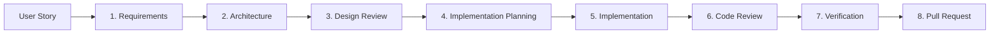
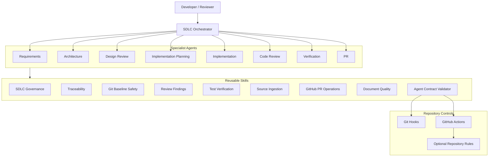
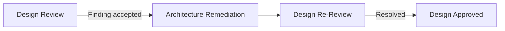
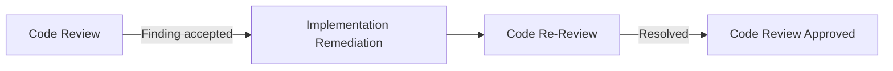
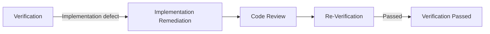

# Agentic SDLC Framework with GitHub Copilot

A reusable learning project that demonstrates how **GitHub Copilot custom agents, reusable skills, human approval gates, traceability, review loops, verification, GitHub automation, and repository guardrails** can be combined into a governed Agentic Software Development Life Cycle.

The framework is designed to be application-agnostic and can be used as a foundation for different programming languages, technology stacks, and software projects.

---

## Overview

Traditional AI-assisted development often uses a single assistant for requirements, design, coding, testing, and review.

This project deliberately separates those responsibilities.

Each SDLC phase is handled by a dedicated specialist agent, while an SDLC Orchestrator coordinates the lifecycle and reusable skills provide shared governance and engineering procedures.

The goal is to demonstrate:

- separation of responsibilities between AI agents
- human-in-the-loop governance
- requirements-to-code traceability
- independent architecture and code reviews
- controlled remediation loops
- verification based on real evidence
- safe Git operations
- reusable agent skills
- automated framework validation
- GitHub-based delivery

---

# Agentic SDLC Lifecycle

The framework implements eight governed lifecycle phases:



The canonical traceability chain is:

```text
User Story
→ FR / BR / NFR / AC
→ CMP / AD
→ DR
→ TASK
→ Code / Tests
→ CR
→ VC / VR
→ PR
```

---

# Architecture

The framework follows a layered architecture:



See the detailed architecture documentation:

[`docs/architecture/framework-overview.md`](docs/architecture/framework-overview.md)

---

# Core Design Principles

## Specialist Ownership

Every lifecycle phase has a dedicated specialist.

A downstream agent must not silently repair an upstream artifact.

For example:

```text
Architecture problem found during Design Review
        ↓
route to Architecture Agent
        ↓
Architecture Agent performs remediation
        ↓
Design Review Agent performs independent re-review
```

The reviewer never silently fixes the work it is reviewing.

---

## Human-in-the-Loop Governance

AI agents must not fabricate human approvals or decisions.

Human interaction is required where appropriate for:

- requirements clarification
- requirements approval
- architecture clarification
- Design Review finding decisions
- implementation-plan clarification
- implementation-plan approval
- Code Review finding decisions
- governed Verification decisions
- external authorization
- governance exceptions
- final Pull Request merge

---

## Permanent Traceability

Lifecycle artifacts use stable identifiers.

Examples:

| Namespace | Purpose |
|---|---|
| `RQ-###` | Requirements clarification |
| `FR-###` | Functional requirement |
| `BR-###` | Business rule |
| `NFR-###` | Non-functional requirement |
| `AC-###` | Acceptance criterion |
| `AQ-###` | Architecture question |
| `CMP-###` | Architecture component |
| `AD-###` | Architecture decision |
| `ARISK-###` | Architecture risk |
| `DR-###` | Design Review finding |
| `PQ-###` | Planning question |
| `TASK-###` | Implementation task |
| `CR-###` | Code Review finding |
| `VC-###` | Verification case |
| `VR-###` | Verification finding |

IDs must not be reused for unrelated lifecycle items.

---

# Agents

Custom agents are stored in:

```text
.github/agents/
```

The framework includes:

| Agent | Responsibility |
|---|---|
| `requirements` | Analyze source stories and create governed requirements |
| `architecture` | Design the system architecture |
| `design-review` | Independently review architecture |
| `implementation-planning` | Convert approved design into executable tasks |
| `implementation` | Implement one governed work item at a time |
| `code-review` | Independently review implementation |
| `verification` | Execute final functional and technical verification |
| `pr` | Prepare and create/update the Pull Request |
| `sdlc-orchestrator` | Coordinate lifecycle routing and gates |

The orchestrator coordinates specialist agents but does not perform specialist lifecycle work itself.

---

# Reusable Skills

Reusable procedures are stored under:

```text
.github/skills/
```

Current shared skills include:

| Skill | Responsibility |
|---|---|
| `sdlc-governance` | Lifecycle gates, routing and stale-state handling |
| `git-baseline-safety` | Safe Git operations and baseline integrity |
| `sdlc-traceability` | Permanent IDs and lifecycle traceability |
| `review-findings` | DR/CR/VR finding lifecycle |
| `test-verification` | Test execution and evidence rules |
| `source-ingestion` | Read-only story/source normalization |
| `github-pr-operations` | Safe GitHub Pull Request operations |
| `document-quality` | Lifecycle-document quality checks |
| `agent-contract-validator` | Static framework contract validation |

Detailed procedures belong in skills instead of being duplicated across multiple agents.

---

# Lifecycle Artifacts

For an application whose project root is `<PROJECT_ROOT>`, lifecycle artifacts are stored under:

```text
<PROJECT_ROOT>/docs/sdlc/
```

Typical artifacts are:

```text
docs/sdlc/
├── requirements.md
├── architecture.md
├── design-review.md
├── impl-plan.md
├── implementation-log.md
├── code-review.md
├── verification.md
└── orchestration-state.md
```

Each specialist agent owns its corresponding artifact.

---

# Lifecycle Gates

The main lifecycle states are:

```text
Requirements Status: APPROVED

Architecture Status: READY_FOR_DESIGN_REVIEW

Architecture Status: DESIGN_REVIEW_APPROVED

Design Review Status: DESIGN_REVIEW_APPROVED

Implementation Plan Status: READY_FOR_IMPLEMENTATION

Implementation Plan Approval: APPROVED

Implementation Status: READY_FOR_CODE_REVIEW

Code Review Status: CODE_REVIEW_APPROVED

Verification Status: VERIFICATION_PASSED

PR Status: PR_CREATED
or
PR Status: PR_UPDATED

Agentic SDLC Status: COMPLETE
```

A later phase cannot treat an incomplete earlier phase as approved.

---

# Remediation Model

The framework uses controlled remediation rather than silent correction.

## Design Review



Only the Design Review Agent resolves `DR-###` findings.

## Code Review



Only the Code Review Agent resolves `CR-###` findings.

## Verification



Only the Verification Agent resolves `VR-###` findings.

---

# Repository Structure

```text
.
├── .github/
│   ├── agents/
│   │   ├── requirements.agent.md
│   │   ├── architecture.agent.md
│   │   ├── design-review.agent.md
│   │   ├── implementation-planning.agent.md
│   │   ├── implementation.agent.md
│   │   ├── code-review.agent.md
│   │   ├── verification.agent.md
│   │   ├── pr.agent.md
│   │   └── sdlc-orchestrator.agent.md
│   │
│   ├── skills/
│   │   ├── sdlc-governance/
│   │   ├── git-baseline-safety/
│   │   ├── sdlc-traceability/
│   │   ├── review-findings/
│   │   ├── test-verification/
│   │   ├── source-ingestion/
│   │   ├── github-pr-operations/
│   │   ├── document-quality/
│   │   └── agent-contract-validator/
│   │
│   ├── workflows/
│   │   └── validate-agent-framework.yml
│   │
│   └── copilot-instructions.md
│
├── .githooks/
│   ├── pre-commit
│   ├── pre-push
│   └── commit-msg
│
├── docs/
│   └── architecture/
│       └── framework-overview.md
│
├── scripts/
│   └── setup-hooks.sh
│
└── README.md
```

---

# Getting Started

## 1. Clone the Repository

```bash
git clone <repository-url>
cd sdlc-ai-agents-copilot
```

---

## 2. Configure Repository Git Hooks

Run:

```bash
chmod +x scripts/setup-hooks.sh
./scripts/setup-hooks.sh
```

Verify:

```bash
git config --get core.hooksPath
```

Expected:

```text
.githooks
```

---

## 3. Verify Python

The contract validator requires Python 3.

```bash
python3 --version
```

---

## 4. Validate the Agent Framework

Run:

```bash
python3 .github/skills/agent-contract-validator/validate_agents.py
```

The desired result is:

```text
Result: PASS
Errors: 0
Warnings: 0
```

Do not treat the framework as validated unless this command was actually executed successfully.

---

# Local Repository Guardrails

The project includes repository-managed Git hooks.

## Pre-Commit

Runs framework validation when relevant agent or skill files are staged.

```text
git commit
    ↓
pre-commit
    ↓
agent-contract-validator
```

## Commit Message

Commit messages follow a conventional structure:

```text
type(scope): description
```

Examples:

```text
feat(skills): add document quality skill
refactor(agents): simplify SDLC orchestrator
fix(validator): support VC identifiers
ci(framework): add framework validation workflow
```

## Pre-Push

Before a push, the complete Agentic SDLC contract validator is executed.

```text
git push
    ↓
pre-push
    ↓
agent-contract-validator
```

Local hooks provide fast developer feedback but are not lifecycle agents.

---

# GitHub Actions

The repository can validate the framework through:

```text
.github/workflows/validate-agent-framework.yml
```

The workflow validates:

- agent contracts
- skill contracts
- shell-script syntax
- executable hook permissions
- validator warnings and errors

The target result is:

```text
Errors: 0
Warnings: 0
Result: PASS
```

Repository branch/ruleset enforcement may optionally make this check mandatory before merge.

---

# Using the Framework

## Run the Complete Lifecycle

Example request to the SDLC Orchestrator:

```text
Read the supplied user story and execute the Agentic SDLC lifecycle.
```

The orchestrator determines the earliest unsatisfied gate and delegates each phase to the appropriate specialist.

---

## Run a Specific Phase

Example:

```text
Run Step 3 — Design Review.
```

Only the requested lifecycle phase should be processed.

---

## Implement a Specific Task

Example:

```text
Implement TASK-007.
```

The Implementation Agent processes only the requested task.

---

## Resume an Existing Lifecycle

Example:

```text
Resume the Agentic SDLC.
```

The orchestrator reads the lifecycle artifacts and starts from the earliest unsatisfied valid gate.

---

## Inspect Current State

Example:

```text
Show the current SDLC status.
```

Status inspection must not perform specialist work.

---

# Git Safety

Agents must preserve unrelated repository changes.

Destructive commands such as the following should not be used without explicit authorization:

```text
git reset --hard
git clean -fd
git restore .
force push
history rewriting
```

A Git commit is not equivalent to lifecycle approval.

Material implementation changes can invalidate earlier Code Review or Verification evidence.

---

# Test and Evidence Integrity

The framework uses the following result vocabulary:

```text
PASS
FAIL
BLOCKED
NOT_APPLICABLE
NOT_VERIFIED
```

`BLOCKED` and `NOT_VERIFIED` are never equivalent to `PASS`.

Agents must not claim that tests, builds, checks, validators, workflows, or verification steps passed unless those operations were actually executed and their results observed.

---

# Copilot Repository Instructions

Repository-wide GitHub Copilot conventions are stored in:

```text
.github/copilot-instructions.md
```

The separation of concerns is:

```text
Copilot Instructions
→ repository-wide conventions

Skills
→ reusable procedures

Specialist Agents
→ phase-specific reasoning

SDLC Orchestrator
→ routing and coordination

Git Hooks
→ local feedback

GitHub Actions
→ repository validation

Repository Rules
→ optional merge enforcement

Human Reviewers
→ approvals and final merge
```

---

# Learning Objectives

This repository is intended to explore practical Agentic Software Engineering concepts including:

- multi-agent orchestration
- agent specialization
- reusable skill design
- human approval gates
- independent AI review
- AI remediation loops
- lifecycle state management
- prompt and agent contract design
- deterministic validation around probabilistic agents
- requirements traceability
- test evidence integrity
- Git and GitHub automation
- agent framework evaluation

---

# Planned Learning Enhancements

Potential future enhancements include:

- complete end-to-end sample application
- behavioral agent evaluation scenarios
- completed example lifecycle artifacts
- Architecture Decision Records
- machine-readable lifecycle metadata
- lifecycle observability
- GitHub Issue templates
- Pull Request templates
- framework versioning
- release changelog
- optional repository branch protection

---

# Current Framework Philosophy

The central design principle is:

> AI agents may automate SDLC work, but lifecycle ownership, traceability, evidence, independent review, and human approval boundaries must remain explicit.

The framework therefore combines **agent autonomy with governed software engineering controls**.