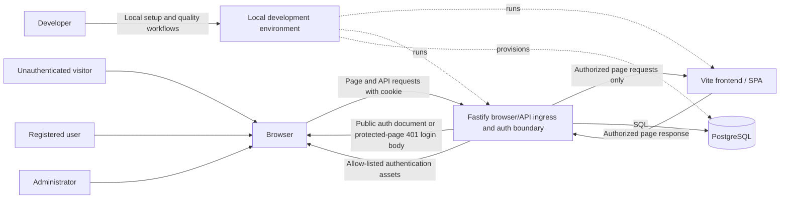
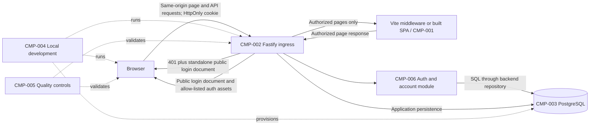
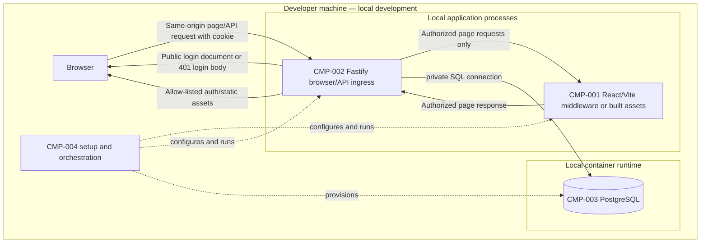

# Architecture Specification

## 1. Metadata

- Project Name: Sports_Paradise
- Project Mode: EXISTING_PROJECT
- Requirements Baseline: `docs/sdlc/requirements.md`, approved SP-1 foundation and SP-2 authentication extension; baseline commit `95a3038`
- Requirements Status: APPROVED
- Architecture Status: DESIGN_REVIEW_APPROVED
- Architecture Version: 2.2

## 2. Executive Architecture Summary

Evolve the existing React/TypeScript/Vite web application, Fastify/TypeScript
API, and PostgreSQL database into a single modular application with
database-backed authentication and account management. Fastify is the
browser-facing HTTP ingress and enforces page and API authorization before
delegating authenticated page requests to Vite development middleware or
built frontend files. Fastify serves the standalone public authentication
document directly, independently of the Vite SPA fallback. Keep
authentication inside the API and use additive user/session data. Do not add a separately deployed
authentication service, Express server, Nginx proxy, external identity
provider, queue, or production infrastructure.

The API issues a signed JWT in an HttpOnly cookie with a 24-hour lifetime.
Each token refers to a server-side session record so logout can revoke just
that session and account deactivation can prevent subsequent authenticated
requests. Argon2id hashes passwords. An allow-list of public routes and static
assets is enforced at the server boundary; all other pages and API operations
require an active account and valid session.

This design maps the approved foundation and authentication requirements while
retaining the existing local-development stack. It is a target design, not
implementation evidence. It records the Architecture remediation for accepted
DR-001, including a standalone public login document delivered as the body of
an unauthenticated protected-page HTTP 401. The independent Design Review
approved Architecture Version 2.2 and resolved DR-001; this status reflects
that approval and does not represent Architecture self-approval.

## 3. Requirements Baseline

The authoritative input is the approved
`docs/sdlc/requirements.md` (SP-1 foundation plus SP-2 authentication and
clarifications). Its architectural drivers include the existing web stack,
signup and login, bcrypt or Argon2 password hashing, an eight-character
password minimum, automatic account activation, administrator account
deactivation, protected application/API operations, 24-hour JWT sessions,
current-session logout, and basic failed-login throttling or temporary
lockout. `/login`, `/signup`, `/health`, and static assets are public;
protected page requests receive HTTP 401 and protected API requests receive
HTTP 401 with `{"error":"Authentication required."}`.

Production deployment, MFA, password recovery, detailed sports-domain
functionality, and requirements beyond the approved baseline are not designed
here.

## 4. Architectural Drivers

| Requirement                            | Architectural implication                                                                                                                                                                                                                                   |
| -------------------------------------- | ----------------------------------------------------------------------------------------------------------------------------------------------------------------------------------------------------------------------------------------------------------- |
| FR-001, FR-006, FR-007, AC-006, AC-007 | The standalone public authentication document and React web routes provide login/signup forms, masked passwords, and required-field feedback.                                                                                                               |
| FR-002, FR-008, FR-009, FR-012, FR-013 | Fastify owns credential validation, registration, authentication, administrator deactivation, and server-side authorization.                                                                                                                                |
| FR-003, FR-012, FR-013                 | PostgreSQL stores users, password hashes, account state, sessions, and login-throttle state.                                                                                                                                                                |
| FR-010, BR-006, AC-010, AC-014         | Server-side route policy protects all pages/API operations except the explicitly public routes and static assets; denied protected pages return HTTP 401 with the standalone public login document, and denied APIs return the specified JSON 401 response. |
| FR-011, AC-011                         | A revocable server-side session record allows logout to invalidate one JWT session.                                                                                                                                                                         |
| BR-005, BR-007, BR-008                 | Authentication checks active account state; email uniqueness and administrator-only deactivation are enforced server-side and in persistent data.                                                                                                           |
| NFR-SEC-001                            | Secrets remain outside source control and browser bundles; required configuration fails visibly without exposing values.                                                                                                                                    |
| NFR-SEC-002, AC-008, AC-013            | Hash passwords with Argon2id and never persist or compare plaintext passwords.                                                                                                                                                                              |
| NFR-SEC-003, AC-009                    | Unknown-user and wrong-password failures use the same generic response; the approved explicit deactivated-account response is a narrowly specified exception.                                                                                               |
| NFR-SEC-004, AC-016                    | Apply a simple temporary delay/lock after repeated failures, without adding a distributed rate-limiting service.                                                                                                                                            |
| NFR-MNT-001, NFR-REL-001, NFR-COMP-001 | Preserve the established TypeScript/PostgreSQL stack and local development conventions; extend existing automated checks and setup.                                                                                                                         |
| Data, Integration, Error Requirements  | Define backend-owned identity/session data, same-origin web/API integration, and explicit authentication/configuration failures.                                                                                                                            |

## 5. Current Architecture

The repository implements an existing local-development application:

- **Web:** React 19, TypeScript, and Vite; `apps/web/src/App.tsx` currently
  displays backend readiness rather than authentication or protected screens.
- **API:** Node.js with TypeScript and Fastify; `apps/api/src/app.ts` currently
  exposes `/health`, `/ready`, `/openapi.json`, and `/api/echo`. It has no
  login, signup, user authorization, or session handling.
- **Persistence:** PostgreSQL 17 with a shared `pg` pool and local Compose
  provisioning. The API has database health-check support and initial
  application-role provisioning, but no user/account schema.
- **Repository/tooling:** npm workspaces, TypeScript, Vitest, ESLint,
  Prettier, and local development scripts.

Current implementation is evidence only. It does not override the approved
authentication behavior.

## 6. Target Architecture

Retain the modular monorepo and local runtime. The browser sends same-origin
page and API requests to the Fastify ingress over HTTP/JSON. The API owns authentication,
authorization, account state, password verification, session lifecycle, and
all database access. PostgreSQL is the source of truth for users, sessions,
and login throttling.

Authentication flow:

1. An unauthenticated visitor may load the standalone public login/signup
   documents and their explicitly allow-listed authentication assets.
2. Signup validates required fields, normalizes email, checks uniqueness,
   hashes the password with Argon2id, and creates an active account in one
   database transaction. Email verification is not part of this design.
3. Login checks the temporary failure delay, loads the account by normalized
   email, verifies the Argon2id hash, and checks active status. On success it
   creates a session record and issues a signed JWT referring to that session.
4. The browser sends the JWT automatically in an HttpOnly cookie. The API
   verifies signature, expiry, account state, and session state before
   authorizing each protected request.
5. Logout revokes the current session record and expires the cookie. Other
   sessions for the account remain valid unless the account is deactivated.
6. An administrator-only operation deactivates the selected account and
   revokes that account's outstanding sessions.

Authentication is a module inside the existing backend, not a new
microservice. CMP-002/Fastify is the sole browser-facing HTTP ingress. Its
request guard runs before any Vite middleware, SPA fallback, or built-file
handler. In local development, Vite middleware is invoked behind this guard
without exposing a second browser-facing listener; when serving built assets,
the same guard runs before static-file and SPA fallback handling.

For direct page navigation, the guard validates the HttpOnly session cookie
through CMP-006. A valid active session proceeds to the Vite page handler or
built SPA document. An absent, invalid, expired, revoked, or deactivated
session receives HTTP 401 with the standalone public login document as the
response body. The same document is served with HTTP 200 at the exact public `/login` route.
It is a CMP-001 authentication entry document, independent of the React/Vite
SPA `index.html`, protected route modules, and SPA fallback. `/signup` serves
that standalone entry document in signup mode. It contains the appropriate
authentication form and uses only explicitly allow-listed authentication
CSS/JavaScript assets; its client submits credentials to the public
authentication API. Asset and form URLs are root-relative and same-origin so
they work when this document is returned for any protected path. CMP-002
serves the standalone document directly as
`text/html; charset=utf-8`, using the same source for `/login` and the
protected-page 401 body. A top-level browser navigation therefore renders the
login form while retaining HTTP 401; no redirect or `Location` header is
returned. The login client posts to the public login API and, on successful
authentication, navigates to the authorized landing page. Fastify halts
protected request processing
before Vite middleware, built SPA files, or the SPA fallback. No protected
page content or protected SPA JavaScript is included in the 401 body. Set
`Cache-Control: no-store` on authentication-dependent responses. Static
assets required by the public authentication document bypass authentication
only through an explicit path/file allow-list; the root path and SPA
`index.html` are not static-asset exemptions. The browser must not bypass
CMP-002 by connecting directly to a Vite listener. API requests continue to
receive the exact required JSON 401 body.

## 7. System Context

**System boundary:** Sports_Paradise web frontend, Fastify browser/API ingress,
and local PostgreSQL. No external identity provider or production runtime is
required.

**Actors:** Unauthenticated visitors, registered users, administrators, and
developers/maintainers. Administrators have only the explicitly required
account-deactivation authority; no wider role or sports-domain permission
model is introduced.

**Trust boundaries:** Browser to web/API server; API to PostgreSQL; local
developer environment to application processes. The browser is untrusted and
never connects directly to PostgreSQL.



## 8. Technology Stack

| Technology                                                           | Purpose                                                                   | Requirements served                             | Rationale                                                                                                                                                                                             | Important alternatives                                                                                            |
| -------------------------------------------------------------------- | ------------------------------------------------------------------------- | ----------------------------------------------- | ----------------------------------------------------------------------------------------------------------------------------------------------------------------------------------------------------- | ----------------------------------------------------------------------------------------------------------------- |
| React, TypeScript, Vite                                              | Protected web UI and local development middleware/build                   | FR-001, FR-005, FR-006, FR-007, FR-010          | Existing compatible web stack; protected frontend handling runs behind the Fastify authorization boundary. The standalone public authentication document is delivered independently of the SPA entry. | Other web frameworks are not justified for this scope.                                                            |
| Node.js, TypeScript, Fastify                                         | Sole browser-facing ingress, page/API authorization, application services | FR-002, FR-008–FR-013, NFR-SEC-003, NFR-SEC-004 | Existing API stack enforces authorization before Vite middleware or built-file fallback and returns the required status and body.                                                                     | A separate Express or Nginx front server adds another runtime/configuration boundary without need in local scope. |
| PostgreSQL and `pg`                                                  | Users, sessions, login throttling, and application persistence            | FR-003, FR-008–FR-013, NFR-REL-001              | Existing persistence layer provides transactions, unique constraints, and local provisioning.                                                                                                         | In-memory identity/session state is not reliable across process restarts.                                         |
| Argon2id                                                             | Password hashing and verification                                         | NFR-SEC-002, AC-008, AC-013                     | One of the approved algorithms; memory-hard password hashing is appropriate for stored user credentials.                                                                                              | bcrypt is allowed by the requirement but is not selected.                                                         |
| Signed JWT plus HttpOnly cookie                                      | Authentication token transport                                            | FR-008, FR-010, FR-011                          | Meets the approved 24-hour JWT requirement while preventing frontend JavaScript from reading the token.                                                                                               | localStorage is permitted by the requirement but is not selected because of script-access exposure.               |
| npm workspaces, Vitest, TypeScript, ESLint, Prettier, Docker Compose | Development and quality controls                                          | FR-004, FR-005, NFR-MNT-001, NFR-REL-001        | Existing tools and repeatable local database setup are retained.                                                                                                                                      | No additional orchestration platform is needed.                                                                   |

Use maintained Node.js libraries for Argon2id, JWT signing/verification, and
cookie handling. Dependency selection and versioning belong to the approved
implementation plan; no dependencies are installed in Step 2.

## 9. Components and Responsibilities

### CMP-001 — Web Frontend

- **Responsibility:** Render dashboard and other authorized user-facing
  screens; provide required-field feedback; own the standalone public
  authentication document and its explicitly allow-listed authentication
  assets, used for login/signup and as the protected-page 401 response body.
- **Requirements:** FR-001, FR-006, FR-007, FR-010, FR-011, FR-012; AC-006,
  AC-007, AC-010–AC-012.
- **Interfaces:** Browser UI; HTTP/JSON API requests to CMP-002.
- **Dependencies:** CMP-002 for all identity, session, and application
  operations.
- **Data ownership:** Transient UI state only. It does not own credentials,
  roles, or authoritative session state.
- **Security:** Password inputs are masked. No JWT is exposed to JavaScript
  under the selected HttpOnly-cookie design. Client route checks are UX only;
  CMP-002 performs authorization before delegating protected page requests to
  the Vite middleware or built SPA handler. The standalone authentication
  document contains no protected application modules or user data.

### CMP-002 — Backend Application and API

- **Responsibility:** Act as the sole browser-facing HTTP ingress; enforce
  route policy before API handlers, Vite middleware, static files, or SPA
  fallback; validate input; authenticate requests; authorize operations; and
  coordinate domain services.
- **Requirements:** FR-002, FR-008–FR-013, BR-005, BR-006, BR-008,
  NFR-SEC-001, NFR-SEC-003, NFR-SEC-004.
- **Interfaces:** HTTP/JSON to CMP-001; SQL to CMP-003.
- **Dependencies:** CMP-003, required configuration, and CMP-006 auth/account
  module.
- **Data ownership:** API-owned persisted business/security state.
- **Security:** Enforce the exact public-route/static-asset allow-list before
  all handlers and frontend fallbacks. Reject unauthenticated protected API
  requests with the required JSON 401. For an unauthenticated protected-page
  request, return HTTP 401 with the standalone public login document directly
  as the response body, then stop processing without invoking Vite or the SPA
  fallback. `/login` serves the same document with HTTP 200. Never redirect a
  protected-page request or return protected content. Admin authorization is
  checked on the server for each privileged operation.

### CMP-003 — Persistence

- **Responsibility:** Persist users, sessions, login-throttle state, and
  application records; enforce integrity and transactions.
- **Requirements:** FR-003, FR-008, FR-011–FR-013, BR-007, BR-008.
- **Interfaces:** Private SQL connection used only by CMP-002.
- **Dependencies:** PostgreSQL service provisioned by CMP-004.
- **Data ownership:** Durable account and application records.
- **Security:** Unique normalized email; never persist plaintext passwords or
  JWT signing secrets. Session and throttle records are accessible only
  through the backend application role.

### CMP-004 — Local Development Environment

- **Responsibility:** Configure and coordinate the Fastify ingress, Vite
  process/build, standalone authentication document/assets, PostgreSQL, and
  contributor workflows.
- **Requirements:** FR-005, BR-003, NFR-REL-001, NFR-SEC-001.
- **Interfaces:** npm scripts, Vite development configuration, Compose, and
  setup documentation.
- **Dependencies:** Developer machine, Node.js toolchain, and compatible
  container runtime for the recommended database path.
- **Data ownership:** None; local database contents are development data.
- **Security:** Local secret-bearing environment files remain ignored; no
  credentials are committed or included in the browser bundle.

### CMP-005 — Engineering Quality Controls

- **Responsibility:** Maintain conventions, type checking, linting,
  formatting, unit/integration tests, and review-ready validation.
- **Requirements:** FR-004, FR-005, NFR-MNT-001.
- **Interfaces:** Repository scripts and contributor documentation.
- **Dependencies:** Existing npm workspaces and TypeScript toolchain.
- **Data ownership:** Test fixtures only; no real credentials or user data.
- **Security:** Authentication tests use synthetic identities and
  non-production secrets.

### CMP-006 — Authentication and Account Management Module

- **Responsibility:** Implement signup, login, password hashing/verification,
  JWT/session lifecycle, login-failure throttling, account-status checks, and
  administrator account deactivation within CMP-002.
- **Requirements:** FR-008–FR-013, BR-005, BR-007, BR-008,
  NFR-SEC-002–NFR-SEC-004.
- **Interfaces:** Internal service boundary called by CMP-002 routes; SQL
  access through CMP-003 repositories.
- **Dependencies:** CMP-002 request context and CMP-003 persistence.
- **Data ownership:** Account credential metadata, account status, session
  lifecycle, and failed-login state.
- **Security:** Hash passwords with Argon2id; prevent self-service elevation;
  require an authenticated administrator for deactivation; revoke sessions
  when deactivating an account.

## 10. Component Diagram



## 11. Data Architecture

- **User account:** Stable ID, normalized unique email, first and last name,
  Argon2id password hash, active/deactivated state, and timestamps. Email
  normalization and uniqueness are enforced server-side and by a database
  constraint.
- **Administrator authority:** A server-managed role/privilege is required
  for deactivation. Users cannot assign or change their own administrator
  privilege. Initial administrator provisioning is out-of-band and performed
  by the local operator through a controlled setup procedure; the public
  signup path never grants administrator privileges.
- **Authentication session:** A record keyed by an opaque session identifier
  (`jti`) associates a user with issued-at/expiry and revocation state. The
  JWT contains only the claims needed to identify the user and session, is
  signed using a secret held outside source control, and expires after
  24 hours. The API checks the session record on protected requests so logout
  can revoke the current session immediately.
- **Failed-login state:** Store bounded counters and cooldown expiry for
  repeated failures, with keys that do not expose raw passwords. Clear or
  expire the state after successful login/cooldown according to the selected
  simple policy.
- **Persistence and consistency:** PostgreSQL remains the single source of
  truth. Use transactions for signup plus related account records, session
  creation, deactivation plus session revocation, and throttle updates where
  needed. Add schema changes with reviewed, versioned migrations; preserve
  existing foundation data.
- **Sensitive data:** Password hashes, session records, and email addresses
  are sensitive application data. Never log passwords, JWTs, cookie values,
  signing keys, or database credentials. No additional retention period is
  specified.

## 12. Data Flow

1. **Signup:** Browser submits first name, last name, email, and password over
   HTTPS where deployed or loopback HTTP locally. CMP-002 validates and
   normalizes input; CMP-006 hashes the password and creates the active user
   through CMP-003. Duplicate email returns a friendly message that may be
   generic to avoid account enumeration.
2. **Login:** Browser submits credentials; CMP-006 checks cooldown, user
   status, and Argon2id hash. Unknown email and wrong password receive the
   same generic invalid-credentials response. A valid deactivated account
   receives the explicit approved support message. Successful login persists
   a session, then CMP-002 sets the HttpOnly JWT cookie.
3. **Protected request:** Browser sends the cookie automatically. CMP-002
   validates the JWT signature and expiry, checks the server-side session and
   active user, authorizes the operation, then uses CMP-003 as needed. An
   unauthorized API request returns the specified 401 JSON.
4. **Direct protected-page request:** The browser sends the requested page
   and cookie to CMP-002. Before invoking Vite middleware, built static-file
   handling, or the SPA fallback, CMP-002 validates the session through
   CMP-006. A valid session proceeds to the page handler. An unauthenticated
   request returns HTTP 401 with the standalone public login document as the
   body, then stops; it is not redirected, and protected page content or the
   SPA document is not served. The browser cannot connect directly to Vite to
   bypass this gate.
5. **Logout/deactivation:** Logout revokes only the presented session and
   expires its cookie. Account deactivation changes account state and revokes
   all outstanding sessions for that account.
6. **Local configuration:** CMP-004 loads configuration into the intended
   process. Signing keys and DB credentials never flow to CMP-001 or browser
   assets.

| Flow   | Source → destination                 | Data category                                                         | Processing                                                                                                                                   | Trust boundary                     | Requirements                                   |
| ------ | ------------------------------------ | --------------------------------------------------------------------- | -------------------------------------------------------------------------------------------------------------------------------------------- | ---------------------------------- | ---------------------------------------------- |
| DF-001 | Browser/CMP-001 → CMP-002            | Login/signup input and API requests                                   | Validate; never trust client authorization                                                                                                   | Browser to server                  | FR-006–FR-010, FR-012                          |
| DF-002 | CMP-006/CMP-002 ↔ CMP-003            | User, hash, session, throttle state                                   | Transactional persistence; secrets excluded from logs                                                                                        | API to database                    | FR-003, FR-008–FR-013, NFR-SEC-002–NFR-SEC-004 |
| DF-003 | CMP-002 → browser                    | JWT cookie and auth/API result                                        | HttpOnly cookie; 401 for blocked requests                                                                                                    | Server to browser                  | FR-010, FR-011                                 |
| DF-004 | CMP-004 → local processes            | Environment settings and secret references                            | Startup validation without secret-value output                                                                                               | Developer environment to processes | FR-005, NFR-SEC-001                            |
| DF-005 | Browser → CMP-002; CMP-002 → Browser | Protected page path, session cookie, standalone public login document | Authenticate before Vite/static/SPA fallback; unauthenticated result is HTTP 401 with the standalone login document and no protected content | Browser/server boundary            | FR-006, FR-010, AC-010                         |

```mermaid
sequenceDiagram
    participant B as Browser
    participant A as CMP-002 API
    participant M as CMP-006 Auth module
    participant D as CMP-003 PostgreSQL
    B->>A: POST /api/auth/login (email, password)
    A->>M: Validate credentials and login throttle
    M->>D: Read account and throttle state
    D-->>M: Account status and password hash
    M->>D: Create session on successful active login
    M-->>A: Session ID and token claims
    A-->>B: 200; Set-Cookie HttpOnly JWT, Max-Age 86400
    B->>A: Protected request with cookie
    A->>D: Validate session and account state
    D-->>A: Active session / account
    A-->>B: Authorized response
    B->>A: GET /dashboard without a valid session
    A->>M: Validate session before page handling
    M-->>A: Missing/invalid session
    A-->>B: 401 text/html standalone login document; no redirect or SPA fallback
```

## 13. Interfaces and Integrations

| Interface               | Provider / consumer                         | Purpose                                                                                                         | Authentication / failure behavior                                                                                                                                                                                                                                                                                           | Requirements                  |
| ----------------------- | ------------------------------------------- | --------------------------------------------------------------------------------------------------------------- | --------------------------------------------------------------------------------------------------------------------------------------------------------------------------------------------------------------------------------------------------------------------------------------------------------------------------- | ----------------------------- |
| Login/signup UI         | CMP-001 / browser                           | Register and authenticate users                                                                                 | Standalone public authentication document; `/login` and `/signup` return the appropriate view with HTTP 200; masked password; required-field validation; duplicate feedback may be generic                                                                                                                                  | FR-006, FR-007, FR-012        |
| Auth API                | CMP-002 / CMP-001                           | `POST /api/auth/signup`, `POST /api/auth/login`, authenticated `POST /api/auth/logout`                          | Signup/login public; logout protected; validation and generic invalid-credential errors                                                                                                                                                                                                                                     | FR-007–FR-009, FR-011, FR-012 |
| Account admin API       | CMP-002 / administrator UI                  | `POST /api/admin/users/{id}/deactivate`                                                                         | Requires active authenticated administrator; unauthenticated receives 401; authenticated non-admin is denied                                                                                                                                                                                                                | FR-013, BR-008                |
| Protected API           | CMP-002 / CMP-001                           | All API operations except signup, login, and `/health`                                                          | Require valid active session; 401 JSON `{"error":"Authentication required."}` when absent/invalid                                                                                                                                                                                                                           | FR-010                        |
| Protected pages         | CMP-002 / browser and CMP-001 auth document | `/`, `/dashboard`, and all non-public application pages                                                         | CMP-002 checks the cookie before Vite middleware, static serving, or SPA fallback; unauthenticated requests receive HTTP 401 with the standalone public login document as the response body. No redirect, SPA fallback, or protected page content.                                                                          | FR-006, FR-010                |
| Public endpoints/assets | CMP-002 / browser                           | Exact `/login`, `/signup`, `/health` routes and explicitly allow-listed authentication/static asset paths/files | `/login` and `/signup` serve the standalone authentication document in the respective view with HTTP 200; `/health` returns minimal health only. Authentication CSS/JS assets are explicit allow-list entries. Route matching is exact; `/`, arbitrary filenames, and the SPA `index.html` are not public asset exemptions. | FR-006, FR-010, FR-012        |
| Readiness/OpenAPI       | CMP-002 / operator or developer             | `/ready`, `/openapi.json`                                                                                       | Protected because they are not in the approved public allow-list; health remains public                                                                                                                                                                                                                                     | FR-010                        |
| Persistence             | CMP-003 / CMP-002                           | SQL for identity and application records                                                                        | Private least-privilege DB role; no browser access                                                                                                                                                                                                                                                                          | FR-003, NFR-SEC-001           |

The public-route and static-asset allow-lists are exact and enforced at the
Fastify ingress before protected API handlers or frontend middleware/fallback.
The standalone public authentication document and only its required assets
are served independently of the SPA fallback; its login view is served at
`/login` and reused as the body of an unauthenticated protected-page 401.
Do not make a future API or page route public by default.

## 14. Security Architecture

- **Authentication boundary:** CMP-002 is the only browser-facing ingress.
  Its request guard validates the session cookie before protected API
  handlers, Vite middleware, built static-file handling, or SPA fallback.
  Client-side route checks only support navigation and are not an access
  control. The Vite development listener is not directly exposed to the
  browser.
- **Page response behavior:** Exact public routes and explicitly listed
  static assets bypass authentication. The root page and all other page paths
  are protected. Before invoking a page handler CMP-002 validates the
  HttpOnly session cookie through CMP-006. Invalid or missing sessions receive
  HTTP 401 with the standalone public login document in the response body.
  That document is independently served and shared with the HTTP 200 `/login`
  route; it contains the login form and references only explicitly
  allow-listed authentication CSS/JavaScript assets. Its login client submits
  to the public login API. The response does not redirect, invoke Vite/SPA
  fallback, or include protected page content. Do not classify `index.html`,
  protected bundles, or arbitrary root files as public assets.
- **Authorization:** The API checks an administrator privilege on the
  deactivation operation. Public signup cannot set privileged fields.
  Authenticated non-administrators cannot deactivate accounts.
- **JWT and cookie:** Use a maintained library with a fixed algorithm
  allow-list; verify signature, issuer/audience where configured, expiry, and
  session ID. Set cookie `HttpOnly`, `SameSite=Lax`, `Path=/`, and a 24-hour
  max age; set `Secure` in HTTPS environments. Never place the JWT in
  localStorage or expose it to JavaScript under this architecture.
- **CSRF and origins:** Because cookies are sent automatically, restrict
  credentialed cross-origin access to the configured web origin, validate
  `Origin` on state-changing browser requests, and use SameSite cookie
  behavior. Use a same-origin development proxy where practical. Do not use
  wildcard credentialed CORS.
- **Password handling:** Enforce the eight-character minimum at signup and
  hash with Argon2id using library defaults or reviewed secure parameters.
  Compare hashes using the library's verification function. Never log or
  persist plaintext credentials.
- **Failure privacy:** Wrong password and unknown account use equivalent
  generic error text. The explicitly required deactivated-account message is
  the exception. Avoid materially different response timing for unknown
  accounts where practical.
- **Failed-login controls:** Apply the simple cooldown/temporary-lockout
  policy in CMP-006; a five-failure threshold is acceptable. Keep counters
  bounded and clear/expire them according to policy. Do not add distributed
  infrastructure for this local PoC.
- **Account deactivation:** Only an administrator can deactivate. Reject new
  logins for deactivated accounts and revoke their sessions so old tokens
  cannot continue to authorize requests.
- **Secrets and database:** Keep JWT signing key and DB credentials in
  untracked local configuration; fail startup if required settings are absent
  and redact them from errors. Database access remains backend-only and
  least-privilege.
- **Transport and audit:** Use HTTPS outside local loopback development.
  Record administrative deactivation events without recording credentials,
  cookies, or JWTs; no broader audit platform is required.
- **Coverage:** NFR-SEC-001–NFR-SEC-004, FR-008–FR-013, BR-005–BR-008.

## 15. Reliability and Error Handling

- Missing signing-key/database configuration fails startup with actionable
  setting names and no secret values. Dependency failure is not reported as
  successful authentication or readiness.
- Invalid, expired, revoked, or deactivated-account sessions are rejected.
  Protected APIs return HTTP 401 with the required JSON body. Authenticated
  but unauthorized administrative actions return HTTP 403.
- Invalid credentials return a generic failure without session creation.
  Signup validation and duplicate-email failures do not create duplicate
  accounts.
- Use database transactions for account creation, session creation, account
  deactivation/session revocation, and throttle updates where atomicity is
  required.
- Do not automatically retry non-idempotent signup or deactivation writes.
  The client may safely retry only when the API operation is designed for
  idempotency.
- The existing public `/health` remains a shallow API process health signal;
  `/ready` checks database readiness and is protected under the public-route
  allow-list.
- Requirements: FR-005, FR-008–FR-013, NFR-REL-001, NFR-SEC-001,
  NFR-SEC-003, NFR-SEC-004.

## 16. Performance and Scalability

No numeric latency, load, or availability targets are specified. Keep the
existing single API process and PostgreSQL design. Password hashing is
intentionally more expensive than ordinary request validation; bound login
attempts with the required throttle. Session checks add a database lookup per
protected request, chosen to ensure revocation and account deactivation take
effect immediately. Do not add a cache, queue, or horizontal-scaling design
without measured need and approved requirements.

## 17. Observability

Retain local process logs and health/readiness signals. Log authentication
outcomes and administrator deactivation at a level sufficient for local
diagnostics, without recording passwords, password hashes, JWTs, cookies,
signing keys, or full sensitive request bodies. Do not expose detailed
database/readiness internals from public `/health`. Metrics, tracing, alerting,
and production audit infrastructure are outside the approved local-only
scope.

## 18. Deployment Architecture

The approved runtime scope is local development. Preserve the Vite frontend,
Fastify API, and PostgreSQL Compose service, but make Fastify the sole
browser-facing HTTP ingress. In development, Fastify invokes Vite development
middleware only after applying the page request policy; for built local runs,
Fastify applies the same policy before serving Vite `dist` files and the SPA
fallback. Do not expose a separate Vite browser port that bypasses the
policy. Same-origin API calls and any required Vite HMR traffic must pass
through the configured ingress boundary.

CMP-001 owns one standalone authentication HTML document and its minimal
authentication-only CSS/JavaScript assets, separate from the Vite SPA entry
and its generated route bundles. CMP-002 serves that document directly at
`/login` and `/signup` (HTTP 200, with the respective form mode), and directly
as the body of an unauthenticated protected-page response (HTTP 401). The
development and built local setup must make this document and its
allow-listed assets available to Fastify without invoking the Vite middleware
or SPA fallback to create the 401 body. Fastify sets the document content
type and `Cache-Control: no-store`, sends no `Location` header, and uses
root-relative same-origin asset/form paths so the document remains functional
at a protected URL. The standalone login client posts to the public auth API.
Neither route matching nor asset resolution may expose protected SPA modules.

Before forwarding a document request to Vite or its SPA fallback, Fastify
matches the normalized path against exact public routes and an explicit
static-asset allow-list. `/login`, `/signup`, `/health`, and listed
authentication/static assets are public. `/login` serves the standalone
public login document with HTTP 200. That same document is returned directly
as the body of an HTTP 401 response for an unauthenticated protected-page
request. It is a separately served authentication entry document, not the
React/Vite SPA `index.html`, a protected route module, or the SPA fallback.
Its form uses only explicitly allow-listed authentication assets and submits
credentials to the public login API using root-relative same-origin URLs.
Fastify stops the protected request after producing this response; it does
not redirect or invoke Vite/SPA
fallback. `/`, `/dashboard`, and every other page route are protected.
Matching must not make paths such as `/healthcheck` or arbitrary files public
by prefix accident. Authenticated page requests proceed to the frontend
handler. No protected page content is included in the 401 response. Set
`Cache-Control: no-store` on authentication-dependent responses. Protected
API requests return HTTP 401 with
`{"error":"Authentication required."}`.

This uses the existing Fastify boundary. Express and Nginx are not selected:
they would add a runtime or infrastructure component without a need in the
approved local scope. Production topology is not specified.



## 19. Configuration and Secrets

Configuration includes API/database endpoints, permitted web origin, runtime
environment, JWT signing key, cookie security mode, and local database
credentials. Keep secret values in ignored local environment files or an
approved secret store; tracked examples contain placeholders only. Signing
keys must be sufficiently random and must never enter Vite/browser-exposed
variables. Startup validation reports missing setting names and remediation
steps without printing values. Cookies use `Secure` outside loopback HTTP
development.

## 20. Existing Project Change Impact

| Element                                     | Classification | Impact                                                                                                                                                                                            |
| ------------------------------------------- | -------------- | ------------------------------------------------------------------------------------------------------------------------------------------------------------------------------------------------- |
| React/TypeScript/Vite web application       | MODIFIED       | Replace readiness-only shell with signup/dashboard routes and authenticated API client behavior; add the standalone public login document and its authentication assets outside the SPA fallback. |
| Fastify API                                 | MODIFIED       | Add auth/account endpoints, central protected-route enforcement, cookies, direct delivery of the standalone login document for protected-page 401 responses, and exact API 401 behavior.          |
| PostgreSQL persistence                      | MODIFIED       | Add additive account, session, and failed-login state schema/migrations.                                                                                                                          |
| Node.js/TypeScript/Fastify/PostgreSQL stack | UNCHANGED      | Continue the existing approved stack; add only required auth libraries through the planning/implementation gate.                                                                                  |
| Local Compose and npm workspace development | MODIFIED       | Keep PostgreSQL provisioning; route browser traffic through Fastify before Vite middleware or built asset fallback.                                                                               |
| `CMP-006` authentication/account module     | NEW            | Add as an internal backend module, not a separately deployed service.                                                                                                                             |
| Foundation health/readiness/API routes      | MODIFIED       | Keep `/health` public; protect `/ready`, `/openapi.json`, and other operations not explicitly public.                                                                                             |
| Existing foundation records and DB roles    | UNCHANGED      | Preserve existing DB foundation and role setup; use additive migrations and least privilege.                                                                                                      |
| Deprecated or removed components            | None           | No unrelated component is deprecated or removed.                                                                                                                                                  |

## 21. Migration and Compatibility

This is an existing project with a PostgreSQL foundation but no current
account/session implementation. Introduce additive, versioned migrations for
users, sessions, and login-throttle state. Do not drop or rewrite existing
foundation tables or local data. Existing `/health` remains public; behavior
of `/ready`, `/openapi.json`, and `/api/echo` changes to require authentication
because the approved baseline makes all non-exempt operations protected.
Route browser traffic through Fastify before Vite middleware or built-file
fallback so direct unauthenticated protected-page requests receive HTTP 401
without protected content; preserve access to the public login experience and
allow-listed assets. No production data migration or external-client
compatibility policy is implied by the local-only scope.

## 22. Architecture Decisions

### AD-001 — Retain the existing typed TypeScript stack

- **Decision:** Continue React/TypeScript/Vite, Node.js/TypeScript/Fastify,
  PostgreSQL, and Docker Compose for local database provisioning.
- **Requirements:** FR-001–FR-005, BR-001, BR-004, NFR-MNT-001,
  NFR-REL-001, NFR-COMP-001.
- **Context:** This stack is already present in the existing application and
  was previously confirmed compatible with the external preferred baseline.
- **Alternatives:** Replace the stack; introduce a distinct identity platform
  or service.
- **Selected option:** Compatible evolution of the existing stack.
- **Rationale:** Meets the approved requirements without migration or
  unnecessary operational complexity.
- **Consequences:** Existing contributors and tooling remain applicable;
  authentication libraries are added only through approved planning.
- **Risks:** New security dependencies require ongoing updates and review.

### AD-002 — Keep frontend, backend, and persistence as separate concerns

- **Decision:** Preserve the modular application boundaries; do not add
  microservices.
- **Requirements:** FR-001–FR-003, BR-001.
- **Context:** The requirements need distinct web, application, and data
  concerns but no independent deployment or scaling.
- **Alternatives:** Tightly coupled full-stack implementation; distributed
  services.
- **Selected option:** Existing React frontend, Fastify backend, and
  backend-owned PostgreSQL access.
- **Rationale:** Clear responsibilities with low local operating complexity.
- **Consequences:** Frontend/API contract and credentialed request behavior
  must be coordinated.
- **Risks:** A single API process is a local PoC constraint, not an
  availability guarantee.

### AD-003 — Preserve HTTP/JSON and enforce authorization at the server

- **Decision:** Retain the HTTP/JSON API and make CMP-002/Fastify the sole
  browser-facing ingress, with a central public-route allow-list and
  protected page/API checks before frontend fallback.
- **Requirements:** FR-002, FR-006–FR-013, BR-005, BR-006, BR-008.
- **Context:** Every operation other than login, signup, health, and static
  assets must be authenticated.
- **Alternatives:** Client-only route checks; public-by-default API with
  per-feature guards; an additional Express/Nginx front server.
- **Selected option:** Deny by default at the existing Fastify boundary;
  require active user/session and admin privilege where applicable.
- **Rationale:** Client checks can be bypassed and fail to protect API data.
- **Consequences:** New endpoints and page routes must be classified
  explicitly; protected direct page requests return 401 before the Vite
  middleware, static-file handler, or SPA fallback.
- **Risks:** Incorrect public allow-list entries could expose operations;
  route-policy tests are mandatory in implementation and verification.

### AD-004 — Retain PostgreSQL and local reproducible provisioning

- **Decision:** Use existing PostgreSQL for persistent accounts, sessions,
  failed-login state, and future application data; retain Compose locally.
- **Requirements:** FR-003, FR-005, BR-001, BR-003, NFR-REL-001.
- **Context:** The repository already provisions PostgreSQL and connects via
  the backend.
- **Alternatives:** In-memory auth state; a new managed datastore.
- **Selected option:** Additive PostgreSQL migrations and backend-only
  database access.
- **Rationale:** Persisted session revocation and throttle state survive API
  restarts without introducing another service.
- **Consequences:** Protected requests perform a session/account lookup;
  migrations must preserve existing data.
- **Risks:** Database unavailability blocks protected operations and must be
  surfaced clearly.

### AD-005 — Preserve shared automated quality controls

- **Decision:** Extend the existing lint, format, type-check, build, and test
  workflow with auth-focused unit/integration coverage.
- **Requirements:** FR-004, FR-005, BR-002, NFR-MNT-001.
- **Context:** The repository already uses TypeScript, Vitest, ESLint,
  Prettier, and npm workspaces.
- **Alternatives:** Documentation-only checks or separate package-specific
  undisclosed tooling.
- **Selected option:** Continue the existing repository-native controls.
- **Rationale:** Maintains contributor conventions and provides testable
  authorization/security behavior.
- **Consequences:** Add tests for routes, sessions, password handling,
  deactivation, and throttling.
- **Risks:** Security-sensitive paths need explicit coverage beyond ordinary
  happy-path tests.

### AD-006 — Use Argon2id and an HttpOnly JWT cookie backed by revocable sessions

- **Decision:** Hash passwords with Argon2id. Issue a signed JWT in an
  HttpOnly cookie with 24-hour expiry and a server-side session record
  identified by the token's session ID.
- **Requirements:** FR-008, FR-011, FR-012, NFR-SEC-002, AC-008, AC-011,
  AC-013.
- **Context:** The baseline permits bcrypt or Argon2 and prefers HttpOnly
  cookie storage; logout must clear/invalidate only the current session.
- **Alternatives:** bcrypt; localStorage JWT without server-side revocation;
  opaque session cookie.
- **Selected option:** Argon2id with JWT cookie and DB-backed session
  revocation.
- **Rationale:** Satisfies the JWT contract and prevents JavaScript access to
  the token while enabling immediate single-session logout and deactivation
  revocation.
- **Consequences:** JWT signing configuration and an active session lookup
  are required for protected requests; cookie-based CSRF protections are
  required.
- **Risks:** Stolen credentials remain a risk; short token life, cookie
  controls, throttling, and server-side revocation reduce exposure.

### AD-007 — Model accounts explicitly and gate deactivation by administrator privilege

- **Decision:** Store normalized unique email, password hash, profile names,
  active/deactivated status, and a server-managed administrator privilege.
  Permit only administrators to deactivate; prevent public signup from
  assigning privilege.
- **Requirements:** FR-012, FR-013, BR-005, BR-007, BR-008, AC-012, AC-015.
- **Context:** Automatic activation is required, and account deactivation is
  administrator-only.
- **Alternatives:** Trust client-supplied role; omit status and privilege;
  external identity provider.
- **Selected option:** Database-backed user state and server-side admin
  authorization; initial administrator is operator-provisioned outside public
  signup.
- **Rationale:** Enforces least privilege within the existing backend and
  local database.
- **Consequences:** Add account status and role fields; revoke active sessions
  on deactivation; document a safe local admin bootstrap operation.
- **Risks:** Incorrect initial admin provisioning can prevent administration
  or grant excess privilege; limit and audit bootstrap access.

### AD-008 — Use an explicit public-route allow-list and exact 401 responses

- **Decision:** Only `/login`, `/signup`, `/health`, and explicitly
  allow-listed static assets are public. Return HTTP 401 with the standalone
  public login document in the body for unauthenticated protected pages; serve
  that same document with HTTP 200 at `/login`. Return the required JSON body
  for protected APIs.
- **Requirements:** FR-006, FR-010, AC-006, AC-010, AC-014.
- **Context:** User clarification defines protected surface and response
  contract.
- **Alternatives:** Protect selected operations only; redirect protected
  requests to login; broadly exempt the SPA shell or arbitrary root assets;
  expose readiness/docs endpoints.
- **Selected option:** Deny by default at Fastify; match normalized paths
  against exact route and static-asset allow-lists before Vite middleware or
  built SPA fallback. Serve a dedicated CMP-001 authentication document,
  separate from the SPA entry and protected modules, for `/login` and as the
  HTML body of a protected-page HTTP 401. The unauthenticated page response
  is not redirected. JSON error bodies are reserved for API requests.
- **Rationale:** Matches approved access control, including protection for
  `/ready`, OpenAPI, and existing echo operations.
- **Consequences:** Public endpoint/asset additions require explicit
  requirement and design review. The dedicated login document and only its
  required authentication assets are allow-listed; the protected-page 401
  remains HTML with no protected application content.
- **Risks:** Incorrect route matching could accidentally exempt a protected
  path or expose the Vite listener; normalize paths, do not expose a direct
  Vite browser port, and test route boundaries.

### AD-009 — Apply simple persistent failed-login throttling

- **Decision:** Track failed attempts and apply a temporary delay/lock after
  five failures; use a bounded five-minute cooldown as the initial
  implementation recommendation.
- **Requirements:** NFR-SEC-004, AC-016.
- **Context:** The approved requirement accepts basic throttling or temporary
  lockout and gives five failures as an acceptable example.
- **Alternatives:** No protection; in-memory-only throttling; external
  rate-limit service.
- **Selected option:** Small PostgreSQL-backed failure state with a
  five-failure threshold and five-minute cooldown, cleared/expired after
  success/cooldown.
- **Rationale:** Simple for a single local API and survives process restarts.
- **Consequences:** Login attempts update persistent state; exact values are
  configurable in implementation only if that remains within approved
  policy.
- **Risks:** Attackers may cause temporary denial of login; scope attempts by
  account and source as appropriate to mitigate abuse without revealing
  account existence.

### AD-010 — Enforce protected-page requests at the Fastify ingress

- **Decision:** Route all browser page and API requests through CMP-002/Fastify.
  Authenticate protected page requests before invoking Vite development
  middleware, built static-file handling, or the SPA fallback. For an
  unauthenticated protected-page request, return HTTP 401 with the standalone
  CMP-001 login document directly in the response body and halt request
  processing.
- **Requirements:** FR-006, FR-010; AC-006, AC-010.
- **Context:** The approved requirements require unauthenticated visitors to
  see the login page and require direct protected-page requests to receive
  HTTP 401. A client-rendered SPA fallback cannot provide both while keeping
  protected page delivery behind the authorization gate.
- **Alternatives:** Client-side route checks; add an Express middleware server;
  add an Nginx reverse proxy; leave Vite directly browser-accessible; return a
  JSON-only 401 and rely on client-side routing for a full-page navigation.
- **Selected option:** Reuse the existing Fastify boundary as the single
  browser-facing ingress. Serve the standalone public login document at
  `/login` and use the same document as the HTML body on a protected-page 401. Keep that document and its explicitly allow-listed authentication
  assets separate from the React/Vite SPA entry, protected bundles, and SPA
  fallback. Keep Vite development middleware behind the route guard and apply
  the same guard before serving built `dist` files. Express and Nginx are not
  added.
- **Rationale:** This enforces status and authorization before SPA fallback
  without a second public listener or a new server/infrastructure component.
  A JSON-only page response would not display the required login form during
  top-level navigation; the login document in the 401 body provides the
  public login experience without redirect or protected SPA content.
- **Consequences:** Local development and built local runs must ensure page,
  API, standalone auth document/assets, and required HMR traffic flow through
  Fastify. The implementation plan must select a compatible Vite
  middleware/proxy integration without weakening the guard. The login
  document's client submits to the public login API; only successful
  authentication navigates to an authorized application page.
- **Risks:** Misordered middleware, overly broad static-asset exemptions, or
  a direct Vite listener could bypass the guard; route-order and bypass tests
  are required.

## 23. Architecture Traceability Matrix

| Requirement                            | Architectural elements                             | Decision / coverage                                                                               |
| -------------------------------------- | -------------------------------------------------- | ------------------------------------------------------------------------------------------------- |
| FR-001                                 | CMP-001; Sections 7, 9, 13                         | AD-001, AD-002; existing React web UI                                                             |
| FR-002                                 | CMP-002; Sections 6, 9, 13                         | AD-001–AD-003; Fastify API boundary                                                               |
| FR-003                                 | CMP-003; Sections 9, 11, 21                        | AD-004; additive PostgreSQL persistence                                                           |
| FR-004                                 | CMP-005; Sections 8, 9, 22                         | AD-005; existing quality controls                                                                 |
| FR-005                                 | CMP-004, CMP-005; Sections 9, 18, 19               | AD-001, AD-004, AD-005; local development                                                         |
| FR-006, FR-007                         | CMP-001, CMP-002; Sections 9, 13, 14               | Login UI, masked password, required-field validation                                              |
| FR-008                                 | CMP-002, CMP-003, CMP-006; Sections 6, 11–14       | AD-006; Argon2id verification, session creation                                                   |
| FR-009                                 | CMP-002, CMP-006; Sections 11–15                   | AD-007; generic invalid credentials and explicit deactivated message                              |
| FR-010                                 | CMP-001, CMP-002; Sections 6, 7, 9, 10, 13, 14, 18 | AD-003, AD-008, AD-010; deny-by-default and 401 before frontend fallback                          |
| FR-011                                 | CMP-002, CMP-003, CMP-006; Sections 6, 11–14       | AD-006; revoke current session and clear cookie                                                   |
| FR-012                                 | CMP-001–CMP-003, CMP-006; Sections 11–14           | AD-006, AD-007; unique email, 8-character minimum, auto-activation                                |
| FR-013                                 | CMP-002, CMP-003, CMP-006; Sections 9, 11, 13, 14  | AD-007; administrator-only deactivation and session revocation                                    |
| BR-001                                 | CMP-001–CMP-003; Sections 6, 9, 10                 | AD-002; separated concerns                                                                        |
| BR-002                                 | CMP-005; Sections 8, 9, 22                         | AD-005; repeatable quality controls                                                               |
| BR-003                                 | CMP-004; Sections 9, 18, 19                        | AD-001, AD-004; local setup                                                                       |
| BR-004                                 | CMP-001; Sections 7, 8                             | AD-001; web-only delivery                                                                         |
| BR-005, BR-006                         | CMP-002, CMP-006; Sections 6, 13, 14               | AD-003, AD-006, AD-008; active account and session required                                       |
| BR-007                                 | CMP-003, CMP-006; Sections 11, 12                  | AD-007; normalized unique email                                                                   |
| BR-008                                 | CMP-002, CMP-006; Sections 9, 11, 14               | AD-007; admin authorization and deactivation                                                      |
| NFR-MNT-001                            | CMP-001, CMP-002, CMP-005; Sections 8, 9, 22       | AD-001, AD-005                                                                                    |
| NFR-REL-001                            | CMP-003, CMP-004; Sections 11, 15, 18              | AD-004; persistent local DB, visible failure                                                      |
| NFR-SEC-001                            | CMP-002–CMP-004; Sections 14, 19                   | Secret separation, startup validation                                                             |
| NFR-SEC-002                            | CMP-006; Sections 8, 11, 14                        | AD-006; Argon2id and no plaintext password                                                        |
| NFR-SEC-003                            | CMP-002, CMP-006; Sections 12, 14, 15              | Generic unknown/wrong-password response; specified deactivated exception                          |
| NFR-SEC-004                            | CMP-003, CMP-006; Sections 11, 14, 22              | AD-009; bounded persistent cooldown                                                               |
| NFR-COMP-001                           | CMP-001–CMP-005; Sections 5, 8, 22                 | AD-001 retains confirmed stack                                                                    |
| Data Requirements                      | CMP-003, CMP-006; Sections 11, 14, 19, 21          | Account/session/throttle data and secrets controls                                                |
| Integration Requirements               | CMP-001, CMP-002, CMP-003; Sections 7, 12, 13      | HTTP/JSON and backend-only SQL                                                                    |
| Error and Edge-Case Behavior           | CMP-001, CMP-002, CMP-006; Sections 13–15          | Validation, generic failures, 401 and cooldown                                                    |
| AC-001, AC-002, AC-003, AC-004, AC-005 | CMP-001–CMP-005; Sections 8, 9, 18                 | Foundation requirements retained                                                                  |
| AC-006–AC-007                          | CMP-001, CMP-002; Sections 9, 13                   | Login screen and required-field behavior                                                          |
| AC-008, AC-013                         | CMP-002, CMP-003, CMP-006; Sections 11–14          | Valid login and password hashing                                                                  |
| AC-009                                 | CMP-002, CMP-006; Sections 12, 14                  | Invalid credential privacy and deactivated-account message                                        |
| AC-010, AC-014                         | CMP-001, CMP-002; Sections 6, 9, 10, 13, 14, 18    | Standalone login document in protected-page HTTP 401; exact API JSON 401 before frontend fallback |
| AC-011                                 | CMP-002, CMP-003, CMP-006; Sections 11, 12         | Current-session revocation                                                                        |
| AC-012                                 | CMP-001, CMP-003, CMP-006; Sections 11–14          | Signup, activation, email uniqueness, duplicate feedback                                          |
| AC-015                                 | CMP-002, CMP-003, CMP-006; Sections 11, 13, 14     | Admin deactivation                                                                                |
| AC-016                                 | CMP-003, CMP-006; Sections 11, 14, 22              | Password minimum and failed-login cooldown                                                        |

## 24. Architecture Risks

### ARISK-001 — External preferred-stack mismatch (historically resolved)

- **Area:** Technology selection.
- **Description:** The prior foundation had to confirm compatibility with an
  externally defined preferred stack.
- **Trigger:** Reopens only if the organization changes that external standard.
- **Impact:** Stack replacement could create migration/rework.
- **Mitigation:** Retain the confirmed existing TypeScript/PostgreSQL stack.
- **Requirement affected:** NFR-COMP-001.
- **Residual risk:** None currently identified; ID retained for history.

### ARISK-002 — Future domain data and access needs remain unspecified

- **Area:** Data and authorization scope.
- **Description:** Sports-domain data, retention, and permissions beyond the
  approved account-deactivation operation are not defined.
- **Trigger:** A future feature introduces additional protected workflows or
  sensitive data.
- **Impact:** Further data classification, authorization, retention, or audit
  controls may be needed.
- **Mitigation:** Treat this design's admin privilege and account controls as
  limited to current requirements; require approved requirements for new
  workflows.
- **Requirement affected:** FR-001–FR-003, FR-010, NFR-SEC-001.
- **Residual risk:** Accepted within this approved scope; reassess with future
  requirements.

### ARISK-003 — Initial administrator provisioning

- **Area:** Privileged access.
- **Description:** FR-013 requires an administrator but the approved
  requirements do not define administrator onboarding or provisioning policy.
- **Trigger:** First local environment setup or loss of all administrator
  access.
- **Impact:** Unsafe bootstrap could grant unauthorized deactivation
  privileges, or no administrator may be able to perform the required
  operation.
- **Mitigation:** Do not permit public signup to grant admin privileges;
  provision the initial local administrator through a controlled operator
  procedure and document the action in implementation/setup guidance.
- **Requirement affected:** FR-013, BR-008.
- **Residual risk:** Local operator authority and recovery remain outside the
  defined product workflow; keep bootstrap out of public API routes.

## 25. Architecture Assumptions

- The current React/Vite, Fastify, and PostgreSQL stack remains the intended
  implementation baseline, consistent with NFR-COMP-001 and existing
  repository evidence.
- Initial administrator access is provisioned by a local operator through a
  controlled mechanism, never by public signup. This is a technical bootstrap
  assumption, not an added public account-management requirement.
- A five-failure, five-minute temporary cooldown is a reasonable initial
  implementation of NFR-SEC-004's permitted simple protection; implementation
  must retain an understandable recovery path after cooldown.
- The local development environment can use loopback HTTP; deployed
  environments must use HTTPS to protect cookies and credentials.
- No sports-domain data model, external identity integration, MFA, password
  recovery, or production hosting is introduced.

## 26. Open Architecture Questions

### AQ-001 — Existing stack confirmation (resolved)

Retained from Architecture Version 1.1: the existing TypeScript/PostgreSQL
stack satisfies the externally preferred stack constraint. This ID retains
its original meaning.

None blocking. No new AQ IDs were required; the remaining implementation
choices are technical details within the approved architecture and stated
assumptions.

## 27. Requirements Gaps

None. The approved baseline specifies account deactivation authority, public
routes, protected response behavior, token lifetime/storage preference,
password hashing/minimum length, and failed-login protection. Initial local
administrator provisioning is documented as an out-of-band technical
assumption and does not grant public self-service privilege.

## 28. Design Review Remediation

### DR-001 — Accepted; Architecture change required

- **Original Design Review Decision:** ACCEPTED; Architecture Change
  Required: YES. The finding was `REMEDIATION_REQUIRED` before remediation.
- **Required Architecture Outcome:** Intercept direct protected-page
  requests at Fastify before Vite middleware or SPA fallback; preserve HTTP
  401 without protected content; keep public routes and explicitly
  allow-listed static assets accessible; return a usable standalone public
  login document in the 401 body without redirecting the request.
- **Architecture Sections Changed:** 1–2, 4, 6–10, 12–14, 18, 20–23, 28–29.
- **Related Architecture Decisions:** AD-003, AD-008, and new AD-010.
- **Related Components:** CMP-001 and CMP-002.
- **Related Requirements:** FR-006, FR-010, AC-006, AC-010.
- **Remediation Summary:** Architecture Version 2.2 establishes CMP-002/
  Fastify as the sole browser-facing ingress. CMP-001 owns a standalone
  authentication HTML document separate from the Vite SPA entry and
  protected bundles. Fastify serves that document directly at `/login` and
  `/signup`, and returns the login view from the same source as `text/html`
  with HTTP 401 on unauthenticated protected-page requests, setting
  `Cache-Control: no-store`. The document's explicit allow-listed assets
  support the public login form, which submits to the public auth API. The
  guard halts before Vite middleware, built SPA files, or SPA fallback; it
  does not redirect or return protected page content. Express and Nginx are
  not selected.
- **Evidence / Verification Expectation:** Version 2.2 specifies the
  document source, status/content-type behavior, guard order, and asset
  boundary. Independent re-review should verify direct unauthenticated page
  navigation receives a renderable login form with HTTP 401, no redirect,
  no `Location` header, no protected SPA content, and
  `Cache-Control: no-store`; root-relative authentication assets load and the
  form submits to the public login API from the protected URL; authenticated
  page access reaches the app; `/login` and `/signup` remain public; only
  explicitly allow-listed authentication assets are public; API 401 remains
  the required JSON; and a direct Vite listener cannot bypass Fastify.
- **Remediation Handoff:** READY_FOR_REREVIEW; subsequently independently
  re-reviewed and resolved in Design Review Cycle 4 against Architecture
  Version 2.2. See `docs/sdlc/design-review.md`.

The previous independent Design Review found the Version 2.1 login-view
delivery contract insufficient. Architecture Version 2.2 specifies the
standalone response document and its relationship to the public routes.
Design Review Cycle 4 independently confirmed the required outcome and
recorded `DR-001: RESOLVED` and `Design Review Status:
DESIGN_REVIEW_APPROVED` for this Version 2.2 baseline.

## 29. Design Review Readiness

- **Requirements coverage:** All FR-001–FR-013 and BR-001–BR-008 have
  architectural coverage in Section 23.
- **NFR coverage:** NFR-MNT-001, NFR-REL-001, NFR-SEC-001–NFR-SEC-004, and
  NFR-COMP-001 are mapped to architecture controls.
- **Diagram completeness:** System context, component, data-flow/sequence,
  and local deployment diagrams correspond to named components and flows,
  including the Fastify page-request gate and standalone public login response.
- **Protected-page response contract:** An unauthenticated protected-page
  request returns HTTP 401 with the standalone login document as HTML, no
  redirect, no protected SPA content, and `Cache-Control: no-store`;
  authenticated access and public routes/assets remain distinct.
- **Open architecture questions:** None blocking; AQ-001 is historical and
  resolved.
- **Requirements gaps:** None identified.
- **Known risks:** ARISK-001 (historical), ARISK-002, and ARISK-003.
- **DR remediation state:** DR-001 is `RESOLVED` by independent Design
  Review Cycle 4 for Architecture Version 2.2.
- **Review status:** DESIGN_REVIEW_APPROVED; synchronized from
  `docs/sdlc/design-review.md`.
