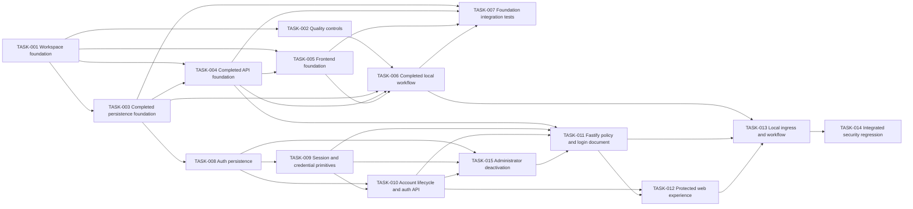

# Implementation Plan

## 1. Metadata

- Project Name: Sports_Paradise
- Project Mode: EXISTING_PROJECT
- Project Root: `C:\Users\prashant_chauhan\Desktop\AI_AGENTS_PROJECT\copilot\sdlc-ai-agents-copilot\Sports_Paradise`
- Requirements Baseline: SP-1 foundation and approved SP-2 authentication extension; `docs/sdlc/requirements.md`; APPROVED; baseline commit `95a3038aa0eec16e313224897b624bcee60413d0`
- Architecture Baseline: Version 2.2; `docs/sdlc/architecture.md`; DESIGN_REVIEW_APPROVED; tracked baseline at HEAD `7361959d6a9bebdfee11f9aa0e1ae4c9c59b2e7c`
- Design Review Baseline: Review Cycle 4; `docs/sdlc/design-review.md`; DESIGN_REVIEW_APPROVED; DR-001 RESOLVED against Architecture Version 2.2
- Requirements Status: APPROVED
- Architecture Status: DESIGN_REVIEW_APPROVED
- Design Review Status: DESIGN_REVIEW_APPROVED
- Git Baseline: Repository root is the parent of `Sports_Paradise`; branch `copilot/phase1`; HEAD `7361959d6a9bebdfee11f9aa0e1ae4c9c59b2e7c`; this `impl-plan.md` is the current uncommitted revision candidate; the unrelated modified framework file `.github/agents/implementation-planning.agent.md` remains outside this plan.
- Planning Version: 2.0
- Implementation Plan Status: READY_FOR_IMPLEMENTATION
- Implementation Plan Approval: APPROVED
- Plan Approval Notes: Human explicitly approved Planning Version 2.0 on 2026-10-13. Approval applies to the authentication-extension execution baseline in this revision; no TASK definitions changed during approval processing.

## 2. Planning Objective

Revise the previously approved and completed SP-1 foundation plan to cover the
approved SP-2 authentication extension in the existing Sports_Paradise
application. Add database-backed signup/login, account administration,
revocable 24-hour JWT sessions in HttpOnly cookies, deny-by-default API and
page authorization, and Fastify-first delivery of a standalone login document
for protected-page HTTP 401 responses. This plan adds only the delta to the
completed foundation, preserves its TASK identities/history, and does not
implement production code or tests.

## 3. Implementation Scope

In scope:

- Preserve TASK-001–TASK-007 as completed historical work under approved
  Planning Version 1.0; do not re-execute or redefine those tasks.
- Additive PostgreSQL user, session, and failed-login state migrations.
- Argon2id password hashing, registration/login behavior, account status,
  server-managed administrator deactivation, and bounded failed-login
  throttling.
- Signed 24-hour JWT HttpOnly cookie issuance, validation, current-session
  logout/revocation, and active-account enforcement.
- Fastify route authorization for all non-public APIs/pages; exact public
  routes/assets; required API JSON 401; standalone login HTML returned as the
  body of protected-page HTTP 401 responses.
- Protected React application/dashboard behavior and authenticated API use.
- Fastify-only browser ingress in local development and built local serving,
  including Vite middleware/HMR integration without a browser-accessible
  bypass.
- Auth-focused unit, integration, security, migration, route-boundary, and
  local smoke tests; contributor/admin bootstrap documentation.

Out of scope:

- Sports-domain booking, commerce, content, or other feature workflows.
- MFA, password recovery, external identity providers, distributed rate
  limiting, and complex account lockout policy.
- Production hosting, infrastructure, CI/CD, production operations, and
  service-level targets.
- Native/mobile clients, generalized roles/permissions, or audit infrastructure
  beyond the approved administrator deactivation behavior.
- Unapproved domain data models or retention rules.

## 4. Planning Inputs

- Approved requirements: [`requirements.md`](./requirements.md), SP-1
  foundation plus approved SP-2 authentication extension, `APPROVED`.
- Approved architecture: [`architecture.md`](./architecture.md), Version 2.2,
  `DESIGN_REVIEW_APPROVED`; Fastify is the sole browser-facing ingress and
  authentication is an internal API module.
- Approved design review: [`design-review.md`](./design-review.md), Cycle 4,
  `DESIGN_REVIEW_APPROVED`; DR-001 is `RESOLVED`.
- Repository inspection: Existing npm-workspace project with React 19,
  TypeScript, Vite, Fastify 5, PostgreSQL, `pg`, node-pg-migrate, Vitest,
  ESLint, Prettier, local Compose, and local development scripts. Confirmed
  paths include `apps/api/src/app.ts`, `apps/api/src/config.ts`,
  `apps/api/src/db/`, `apps/api/migrations/`, `apps/web/src/App.tsx`,
  `apps/web/src/api.ts`, `apps/web/vite.config.ts`, `scripts/local-dev.mjs`,
  `package.json`, `compose.yaml`, `database.md`, and
  `development-standards.md`. Current implementation has no authentication,
  account, or session behavior.
- Git inspection: HEAD `7361959d6a9bebdfee11f9aa0e1ae4c9c59b2e7c` on
  `copilot/phase1`; only the implementation-planning agent profile is modified
  outside the project and is not part of this plan.
- Downstream baseline note: the existing implementation log, Code Review, and
  Verification artifacts document the original SP-1 foundation only. Their
  prior completion/approval states do not cover the approved SP-2 extension
  and must not be treated as current authentication implementation,
  review, or verification evidence; Step 5 through Step 7 remain required
  after this plan is approved.

## 5. Delivery Strategy

The original foundation TASK-001–TASK-007 are complete and remain historical.
For the approved authentication delta, first introduce additive identity,
session, and throttle persistence; then build session/token controls and
account/authentication services. Next enforce API/page policy at Fastify and
deliver the standalone public authentication document, implement the protected
web experience, and integrate Vite development/build delivery behind the
Fastify gate. Finish with integrated security and regression evidence. Each
implementation task includes its focused tests; the final task validates
cross-component behavior and the exact direct-navigation 401 contract.

Use maintained libraries compatible with the approved stack for Argon2id,
JWT, and cookie handling. Exact compatible packages/configuration are
implementation-level choices; dependencies must not weaken the approved
architecture or add a service/infrastructure component.

## 6. Execution Waves

### WAVE-1 — Repository Foundation (Complete)

- TASK-001

### WAVE-2 — Quality and Persistence Baselines (Complete)

- TASK-002
- TASK-003

### WAVE-3 — Backend API Foundation (Complete)

- TASK-004

### WAVE-4 — Web Frontend Foundation (Complete)

- TASK-005

### WAVE-5 — Local Developer Workflow (Complete)

- TASK-006

### WAVE-6 — Foundation Integration (Complete)

- TASK-007

### WAVE-7 — Authentication Persistence

- TASK-008

### WAVE-8 — Session and Credential Services

- TASK-009

### WAVE-9 — Account Lifecycle and Authentication API

- TASK-010

### WAVE-10 — Administrator Account Deactivation

- TASK-015

### WAVE-11 — Fastify Authorization and Public Login Delivery

- TASK-011

### WAVE-12 — Protected Web Experience

- TASK-012

### WAVE-13 — Local Ingress and Developer Workflow

- TASK-013

### WAVE-14 — Integrated Security and Regression Evidence

- TASK-014

## 7. Dependency Graph

## 8. Critical Dependency Chain

The main blocking chain for the authentication extension is:

`TASK-008 → TASK-009 → TASK-010 → TASK-015 → TASK-011 → TASK-012 → TASK-013 → TASK-014`

TASK-015 separately depends on TASK-008 and TASK-009. TASK-011 depends on
TASK-009, TASK-010, and TASK-015. Foundation TASK-001–TASK-007 are complete
and are not prerequisites to re-execute in the revised plan.

## 9. Implementation Tasks

TASK-001 through TASK-007 below retain their original approved definitions and
COMPLETE execution evidence from Planning Version 1.0. They are historical
foundation work and are not authorized for re-execution by this revision.

### TASK-001 — Establish repository workspace and TypeScript foundation

- **Task ID:** TASK-001
- **Title:** Establish repository workspace and TypeScript foundation
- **Objective:** Create the greenfield repository/package structure and shared
  TypeScript/build configuration required by the selected web and API stack.
- **Requirements:** FR-001, FR-002, FR-004; NFR-MNT-001, NFR-COMP-001; AC-001,
  AC-002, AC-004.
- **Architecture References:** CMP-001, CMP-002, CMP-005; AD-001, AD-002,
  AD-005; Sections 6, 8, 9.
- **Design Review References:** None.
- **Priority:** P0
- **Execution Wave:** WAVE-1
- **Dependencies:** None
- **Blocks:** TASK-002, TASK-003, TASK-004, TASK-005
- **Parallel With:** None
- **Status:** COMPLETE
- **Verification Result:** PASS
- **Implementation Evidence:** `docs/sdlc/implementation-log.md#task-001`
- **Implementation Scope:** Initialize the single-repository workspace for the
  approved TypeScript frontend/backend stack. Select a package manager and
  workspace mechanism consistent with Node.js/TypeScript; configure common
  build/type-check entry points and separate frontend, backend, and shared
  contract areas. Do not implement product workflows.
- **Expected Files / Areas:**
  - Confirmed existing paths: `Sports_Paradise/docs/sdlc/` governance
    documents only.
  - Anticipated new areas: repository/package manifests and workspace
    configuration; shared TypeScript compiler configuration; frontend,
    backend, and shared-contract package directories; root development
    scripts.
- **Implementation Constraints:** Preserve the approved React/Vite and
  Node.js/Fastify stack; keep frontend, backend, and data concerns separate;
  do not introduce a mobile client or production deployment configuration.
- **Testing Required:** Unit/smoke validation of workspace package discovery,
  build script execution, and TypeScript configuration; verify frontend
  bundles do not receive backend-only configuration.
- **Completion Criteria:** Frontend, backend, and shared contract areas can be
  independently addressed from the workspace; common scripts execute
  successfully; baseline type/build checks pass; package/framework choices
  conform to AD-001.
- **Evidence Expected:** Workspace manifests and configuration diff; successful
  package discovery, type-check, and minimal build output.
- **Risks / Notes:** Avoid coupling package layout to future, unspecified
  domain modules. Do not select an alternate framework under the guise of
  workspace tooling.

### TASK-002 — Establish coding standards and automated quality controls

- **Task ID:** TASK-002
- **Title:** Establish coding standards and automated quality controls
- **Objective:** Define and enforce the shared implementation, validation, and
  review-readiness conventions before feature development scales.
- **Requirements:** FR-004; BR-002; NFR-MNT-001; AC-004.
- **Architecture References:** CMP-005; AD-005; Sections 8, 9.
- **Design Review References:** None.
- **Priority:** P0
- **Execution Wave:** WAVE-2
- **Dependencies:** TASK-001
- **Blocks:** TASK-006
- **Parallel With:** TASK-003
- **Status:** COMPLETE
- **Verification Result:** PASS
- **Implementation Evidence:** `docs/sdlc/implementation-log.md#task-002`
- **Implementation Scope:** Document code structure, formatting, linting,
  type-safety, validation, test, and review conventions. Configure the
  architecture-recommended ESLint/Prettier and TypeScript checks and select a
  compatible test runner. Expose repeatable workspace commands; do not add
  CI/CD, which is outside scope.
- **Expected Files / Areas:**
  - Confirmed existing paths: `Sports_Paradise/docs/sdlc/` only.
  - Anticipated new areas: contributor coding-standard documentation; lint,
    format, test, and type-check configuration; shared package scripts and
    minimal test examples.
- **Implementation Constraints:** Use tools compatible with the confirmed
  stack. Exact test runner and versions are implementation choices; document
  them and avoid undocumented per-package alternatives.
- **Testing Required:** Run formatter check, lint, type checking, and test
  runner against the workspace baseline; include a minimal passing test and
  verify scripts fail with a non-zero result when a check fails.
- **Completion Criteria:** A contributor can find and run documented quality
  commands; frontend and backend are covered by applicable shared checks;
  standards and expected review evidence are documented.
- **Evidence Expected:** Coding convention documentation, tool configurations,
  and captured successful quality-command results.
- **Risks / Notes:** Keep checks proportional to a foundation; do not add
  application rules or unsupported security claims.

### TASK-003 — Establish PostgreSQL persistence and schema conventions

- **Task ID:** TASK-003
- **Title:** Establish PostgreSQL persistence and schema conventions
- **Objective:** Provide the persistent data-store foundation and documented
  schema-evolution conventions for future application data.
- **Requirements:** FR-003, FR-005; BR-001, BR-003; NFR-REL-001, NFR-SEC-001;
  AC-003.
- **Architecture References:** CMP-003, CMP-004; AD-001, AD-002, AD-004;
  Sections 9, 11, 14, 18, 19, 21.
- **Design Review References:** None.
- **Priority:** P0
- **Execution Wave:** WAVE-2
- **Dependencies:** TASK-001
- **Blocks:** TASK-004, TASK-006, TASK-007, TASK-008
- **Parallel With:** TASK-002
- **Status:** COMPLETE
- **Verification Result:** PASS
- **Implementation Evidence:** `docs/sdlc/implementation-log.md#task-003`
- **Implementation Scope:** Provision PostgreSQL for local use through the
  approved Docker Compose approach; define connection configuration, data
  ownership, schema/migration naming and review conventions, and local
  persistence lifecycle. Choose a compatible database access and migration
  tool within the approved stack. Do not invent domain entities or production
  data policies.
- **Expected Files / Areas:**
  - Confirmed existing paths: `Sports_Paradise/docs/sdlc/` only.
  - Anticipated new areas: local Compose database configuration; backend data
    access and migration configuration; placeholder-only environment
    template; ignored local secret configuration; documentation for schema
    conventions and local database lifecycle.
- **Implementation Constraints:** PostgreSQL is the selected store; only the
  backend may access it. Never commit credentials. Do not expose database
  credentials to the browser or expose database service beyond the local
  development need. No domain schema is justified by SP-1.
- **Testing Required:** Validate Compose configuration and database startup;
  verify backend-scoped connection can connect and report unavailable database
  explicitly; validate migration tooling/configuration using only a
  non-domain baseline or tool-level check; test that secret-bearing local
  config is ignored and templates contain no real secrets.
- **Completion Criteria:** PostgreSQL starts reproducibly for local
  development; storage and schema conventions are documented; configuration
  has no committed secret; database access remains backend-only.
- **Evidence Expected:** Compose/database configuration diff, migration/schema
  convention documentation, successful database readiness/connectivity check,
  and secret-ignore validation.
- **Risks / Notes:** Contributors need a compatible local container runtime.
  Document prerequisites and the approved local alternative without changing
  the persistence architecture.

### TASK-004 — Implement the backend API foundation

- **Task ID:** TASK-004
- **Title:** Implement the backend API foundation
- **Objective:** Provide a typed Fastify service boundary with explicit
  configuration, request validation, health/readiness behavior, and a
  documented contract for the frontend.
- **Requirements:** FR-002, FR-003; BR-001; NFR-MNT-001, NFR-REL-001,
  NFR-SEC-001, NFR-COMP-001; AC-002.
- **Architecture References:** CMP-002, CMP-003; AD-001, AD-002, AD-003;
  Sections 9, 12, 13, 14, 15, 17, 19.
- **Design Review References:** None.
- **Priority:** P0
- **Execution Wave:** WAVE-3
- **Dependencies:** TASK-001, TASK-003
- **Blocks:** TASK-005, TASK-006, TASK-007, TASK-011
- **Parallel With:** None
- **Status:** COMPLETE
- **Verification Result:** PASS
- **Implementation Evidence:** `docs/sdlc/implementation-log.md#task-004`
- **Implementation Scope:** Implement the Fastify application entry point,
  environment configuration parsing, required-setting validation, structured
  HTTP error mapping, request schema validation, database connectivity, and
  health/readiness endpoint. Describe the initial API interface with OpenAPI
  3.x. Provide automated unit/component tests. No domain endpoints,
  authentication provider, or assumed administrator permissions.
- **Expected Files / Areas:**
  - Confirmed existing paths: `Sports_Paradise/docs/sdlc/` only.
  - Anticipated new areas: backend application/bootstrap, configuration,
    route/health, error/validation, persistence adapter, OpenAPI contract, and
    backend unit/component tests.
- **Implementation Constraints:** Fastify and TypeScript per AD-001. Backend
  owns application logic and is the only application-level database client.
  Missing required configuration or unavailable required dependencies must
  fail visibly and actionably; errors and logs must not disclose secrets.
- **Testing Required:** Unit tests for configuration validation, invalid
  requests, error mapping, and health/readiness; component tests for database
  dependency success/failure and API contract shape; security checks for
  secret redaction and server-side validation.
- **Completion Criteria:** API starts only with valid required configuration;
  readiness distinguishes unavailable database from healthy service;
  OpenAPI describes the implemented foundation endpoints; no silent in-memory
  or success-shaped fallback exists; tests pass.
- **Evidence Expected:** API source and OpenAPI diff; passing backend tests;
  sample healthy and dependency-failure responses/logs with secrets omitted.
- **Risks / Notes:** SP-1 does not specify production authentication or
  authorization; do not imply that the foundation API is approved for
  protected production use. ARISK-002 remains for future feature requirements.

### TASK-005 — Implement the browser frontend foundation

- **Task ID:** TASK-005
- **Title:** Implement the browser frontend foundation
- **Objective:** Provide a React/TypeScript/Vite browser application shell and
  explicit integration with the backend contract, without adding
  sports-domain workflows.
- **Requirements:** FR-001, FR-002; BR-001, BR-004; NFR-MNT-001, NFR-SEC-001;
  AC-001.
- **Architecture References:** CMP-001, CMP-002; AD-001, AD-002, AD-003;
  Sections 7, 8, 9, 12, 13, 14.
- **Design Review References:** None.
- **Priority:** P1
- **Execution Wave:** WAVE-4
- **Dependencies:** TASK-001, TASK-004
- **Blocks:** TASK-006, TASK-007
- **Parallel With:** None
- **Status:** COMPLETE
- **Verification Result:** PASS
- **Implementation Evidence:** `docs/sdlc/implementation-log.md#task-005`
- **Implementation Scope:** Create a minimal web-only screen foundation,
  frontend structure, and API client boundary compatible with the backend
  OpenAPI contract. Surface service unavailable/error state rather than
  presenting a failed request as success. Do not add product branding,
  booking/content/commerce flows, native clients, or client-side credentials.
- **Expected Files / Areas:**
  - Confirmed existing paths: `Sports_Paradise/docs/sdlc/` only.
  - Anticipated new areas: React application entry point and screen shell,
    API client/configuration, frontend styles/assets as needed, and frontend
    component/unit tests.
- **Implementation Constraints:** React, TypeScript, and Vite per AD-001.
  Browser code must not contain database credentials, server secrets, or
  trusted authorization decisions. Use only web delivery.
- **Testing Required:** Unit/component tests for rendering, API client
  behavior, loading and dependency-failure states; type and build checks;
  contract compatibility checks against the backend's documented interface.
- **Completion Criteria:** A browser can load the frontend shell; its API
  integration targets configuration rather than hard-coded secrets; request
  failure is visible; frontend checks pass and no native or feature-specific
  behavior is added.
- **Evidence Expected:** Frontend source and test diff; successful production
  build; component/API-client test output and contract compatibility result.
- **Risks / Notes:** Keep the UI a foundation only; detailed end-user and
  administrator workflows require separate approved requirements.

### TASK-006 — Wire repeatable local startup and contributor onboarding

- **Task ID:** TASK-006
- **Title:** Wire repeatable local startup and contributor onboarding
- **Objective:** Enable contributors to configure, start, inspect, and stop the
  frontend, backend, and database consistently using documented local steps.
- **Requirements:** FR-005; BR-003; NFR-REL-001, NFR-SEC-001; AC-005.
- **Architecture References:** CMP-001, CMP-002, CMP-003, CMP-004, CMP-005;
  AD-001, AD-004, AD-005; Sections 9, 15, 17, 18, 19.
- **Design Review References:** None.
- **Priority:** P0
- **Execution Wave:** WAVE-5
- **Dependencies:** TASK-002, TASK-003, TASK-004, TASK-005
- **Blocks:** TASK-007, TASK-013
- **Parallel With:** None
- **Status:** COMPLETE
- **Verification Result:** PASS
- **Implementation Evidence:** `docs/sdlc/implementation-log.md#task-006`
- **Implementation Scope:** Add documented local commands to provision the
  database, run frontend and backend development processes, wait for readiness
  where needed, and shut down cleanly. Document prerequisites, configuration
  setup, troubleshooting missing configuration/container/runtime issues,
  health/readiness diagnostics, and secret-safe operation.
- **Expected Files / Areas:**
  - Confirmed existing paths: `Sports_Paradise/docs/sdlc/` only.
  - Anticipated new areas: root development scripts and Compose usage;
    contributor setup/development documentation; environment template and
    local configuration guidance; operational troubleshooting and
    health-check instructions.
- **Implementation Constraints:** Local development only. Preserve the
  frontend/backend/data separation, keep secrets outside tracked source, and
  report missing prerequisites or configuration explicitly. Do not add
  production deployment, hosting, or CI/CD.
- **Testing Required:** Execute documented setup from a clean local
  configuration; verify missing prerequisites/configuration give actionable
  failures; verify startup/readiness and shutdown behavior; confirm no
  secret-bearing files are tracked.
- **Completion Criteria:** A contributor can follow the documented steps with
  only documented prerequisites and minimal manual intervention to run and
  iterate on the application; startup failures identify the action needed;
  local services can be stopped and restarted consistently.
- **Evidence Expected:** Setup documentation and scripts diff; successful
  clean-start smoke-test transcript; documented failure-diagnostic examples;
  tracked-file secret scan result.
- **Risks / Notes:** Docker availability differs by contributor environment.
  Document the compatible-container prerequisite and supported local
  alternative without implying a production topology.

### TASK-007 — Verify integrated foundation, security defaults, and regression

- **Task ID:** TASK-007
- **Title:** Verify integrated foundation, security defaults, and regression
- **Objective:** Test the assembled frontend/API/database/local-environment
  path and demonstrate the approved foundation acceptance criteria and
  failure-handling controls.
- **Requirements:** FR-001, FR-002, FR-003, FR-004, FR-005; BR-001, BR-002,
  BR-003, BR-004; NFR-MNT-001, NFR-REL-001, NFR-SEC-001, NFR-COMP-001;
  AC-001 through AC-005.
- **Architecture References:** CMP-001 through CMP-005; AD-001 through AD-005;
  Sections 7, 9, 11-19, 23.
- **Design Review References:** None.
- **Priority:** P1
- **Execution Wave:** WAVE-6
- **Dependencies:** TASK-003, TASK-004, TASK-005, TASK-006
- **Blocks:** None
- **Parallel With:** None
- **Status:** COMPLETE
- **Verification Result:** PASS
- **Implementation Evidence:** `docs/sdlc/implementation-log.md#task-007`
- **Implementation Scope:** Add and run cross-component integration and
  local-startup smoke tests. Verify frontend-to-API contract behavior,
  backend-to-database connectivity, unavailable dependency and missing
  configuration failures, secret-safe errors/logs, and documented
  contributor-path reproducibility. Add regression coverage for the
  foundation's failure and health/readiness behavior; do not add domain
  feature tests.
- **Expected Files / Areas:**
  - Confirmed existing paths: `Sports_Paradise/docs/sdlc/` only.
  - Anticipated new areas: cross-package integration/component test suites,
    local development smoke-test scripts or instructions, and test evidence
    associated with the workspace's selected test runner.
- **Implementation Constraints:** Test only approved foundation interfaces
  and controls. Use synthetic data and non-secret test configuration.
  Security checks must not imply authentication or domain authorization
  behavior that SP-1 does not define.
- **Testing Required:** Integration, component, security/configuration,
  regression, and end-to-end local-startup smoke tests. Cover normal
  readiness, invalid/missing configuration, unavailable database, malformed
  API input, frontend API failure, and absence of secrets in committed
  configuration/logs.
- **Completion Criteria:** All approved acceptance criteria have an
  objectively verifiable test or setup/documentation result; all required
  foundation quality commands and integrated tests pass; failure paths are
  actionable and do not report false success; no production or domain scope
  has been introduced.
- **Evidence Expected:** Passing integrated test output; smoke-test result
  from documented setup; contract validation; secret/configuration checks;
  traceable test mapping to AC-001 through AC-005.
- **Risks / Notes:** This is implementation-level verification, not final
  Step 7 verification. ARISK-002 remains deferred to future product
  requirements and is not to be silently implemented here.

### TASK-008 — Additive account, session, and login-throttle persistence

- **Task ID:** TASK-008
- **Title:** Additive account, session, and login-throttle persistence
- **Objective:** Add the PostgreSQL structures required for accounts, revocable
  sessions, and bounded failed-login state without altering existing
  foundation data.
- **Requirements:** FR-003, FR-008, FR-011, FR-012, FR-013; BR-007; NFR-SEC-001;
  AC-003, AC-008, AC-011, AC-012, AC-015.
- **Architecture References:** CMP-003, CMP-006; AD-004, AD-006, AD-007;
  Sections 11, 14, 19, 21.
- **Design Review References:** None.
- **Priority:** P0
- **Execution Wave:** WAVE-7
- **Dependencies:** TASK-003
- **Blocks:** TASK-009, TASK-010, TASK-015
- **Parallel With:** None.
- **Status:** COMPLETE
- **Implementation Scope:** Add versioned migrations for normalized unique
  account email, password hash, account activation/deactivation state and
  server-managed administrator privilege; revocable sessions with user,
  expiry, and revocation state; and bounded login-failure/cooldown state.
  Preserve existing foundation tables and records. Keep credentials and
  signing keys out of schema and seed data. Add migration-focused tests or
  validation using the repository's established database test conventions.
- **Expected Files / Areas:**
  - Confirmed existing paths: `apps/api/migrations/`,
    `apps/api/src/db/`, `compose.yaml`, `database.md`.
  - Anticipated new paths: versioned migration files and database tests or
    fixtures under the existing API test layout.
- **Implementation Constraints:** PostgreSQL remains the source of truth;
  use additive/versioned migrations and backend-only access. Do not seed a
  public administrator, store plaintext passwords/JWTs, or add unrelated
  domain tables. Preserve AD-004 and ARISK-003's operator-controlled
  administrator bootstrap boundary.
- **Testing Required:** Migration up/down or repository-standard migration
  validation; unique normalized email and required constraints; session
  revocation/expiry persistence; throttle-state bounds; existing foundation
  schema/data preservation.
- **Completion Criteria:** Migrations apply to the current foundation schema
  without destructive changes; constraints support approved account/session
  semantics; migration and persistence checks pass without committed secrets
  or plaintext credentials.
- **Evidence Expected:** Migration diff, schema/constraint assertions,
  migration execution/test output, and evidence existing foundation schema
  remains intact.
- **Risks / Notes:** No historical user data requires backfill. If the
  approved account/admin model cannot be represented safely as written, route
  the gap to Architecture rather than inventing a different model.

### TASK-009 — Implement signed JWT session and cookie lifecycle

- **Task ID:** TASK-009
- **Title:** Implement signed JWT session and cookie lifecycle
- **Objective:** Provide the backend primitives that issue, validate, and
  revoke one authenticated 24-hour session using the approved HttpOnly cookie.
- **Requirements:** FR-008, FR-010, FR-011; NFR-SEC-001; AC-008, AC-010, AC-011.
- **Architecture References:** CMP-002, CMP-003, CMP-006; AD-003, AD-004,
  AD-006, AD-008; Sections 6, 11, 12, 14, 19.
- **Design Review References:** None.
- **Priority:** P0
- **Execution Wave:** WAVE-8
- **Dependencies:** TASK-008
- **Blocks:** TASK-010, TASK-011, TASK-015
- **Parallel With:** None.
- **Status:** COMPLETE
- **Verification Result:** PASS
- **Implementation Evidence:** `docs/sdlc/implementation-log.md#task-009`
- **Implementation Scope:** Select maintained, compatible JWT and cookie
  libraries; add validated server-only signing configuration; issue
  allow-listed signed tokens with 24-hour expiry and session identifier;
  persist sessions; validate signature, expiry, session state, and active
  account for protected requests; set HttpOnly, SameSite, Path, and
  environment-appropriate Secure cookie attributes; revoke only the presented
  session through the authenticated `POST /api/auth/logout` endpoint and
  expire its cookie. Apply same-origin/Origin checks for cookie-authenticated
  state-changing browser requests as designed.
- **Expected Files / Areas:**
  - Confirmed existing paths: `apps/api/src/app.ts`,
    `apps/api/src/config.ts`, `apps/api/src/db/`, API tests and
    `apps/api/package.json`.
  - Anticipated new paths: authentication/session services, cookie/JWT
    integration, security-focused tests, and server-only environment
    configuration examples as needed.
- **Implementation Constraints:** Never expose tokens to browser JavaScript,
  place JWTs in localStorage, log tokens/cookies/secrets, or accept
  algorithm substitution. Preserve 24-hour expiry and immediate persisted
  revocation; no general-purpose session platform or new service.
- **Testing Required:** Unit/component tests for token issuance and rejection,
  expiry, malformed/invalid signatures, revoked/unknown sessions, inactive
  accounts, cookie attributes, current-session logout, other-session
  preservation, origin/CSRF behavior, and missing-secret startup failure.
- **Completion Criteria:** A session is issued only through a successful
  authenticated flow; protected checks reject invalid/expired/revoked
  sessions and inactive accounts; logout invalidates only the current
  session; all specified cookie/configuration controls are objectively
  demonstrated.
- **Evidence Expected:** Focused tests, relevant implementation diff,
  cookie/header assertions, two-session logout evidence, and startup
  configuration failure evidence with no secret values.
- **Risks / Notes:** Session persistence intentionally adds a database check
  to protected requests to make revocation immediate.

### TASK-010 — Implement account lifecycle and authentication endpoints

- **Task ID:** TASK-010
- **Title:** Implement account lifecycle and authentication endpoints
- **Objective:** Implement signup, credential authentication, failed-login
  protection, and administrator account deactivation within the approved
  account policy.
- **Requirements:** FR-007, FR-008, FR-009, FR-012; BR-005, BR-007;
  NFR-SEC-002, NFR-SEC-003, NFR-SEC-004; AC-007, AC-008, AC-009, AC-012,
  AC-013, AC-016.
- **Architecture References:** CMP-002, CMP-003, CMP-006; AD-006, AD-007,
  AD-009; Sections 11–15.
- **Design Review References:** None.
- **Priority:** P0
- **Execution Wave:** WAVE-9
- **Dependencies:** TASK-008, TASK-009
- **Blocks:** TASK-011, TASK-012, TASK-015
- **Parallel With:** None.
- **Status:** COMPLETE
- **Verification Result:** PASS
- **Implementation Evidence:** `docs/sdlc/implementation-log.md#task-010`
- **Implementation Scope:** Implement public signup and login endpoints,
  server-side input validation, normalized unique email handling, automatic
  activation, eight-character minimum, Argon2id password hashing/verification,
  duplicate-email feedback, generic unknown-user/wrong-password behavior,
  and the specified deactivated-account message. Create an authenticated
  session on successful active login using TASK-009. Apply the approved simple
  persistent failed-login delay/lock policy (Architecture recommends five
  failures and a five-minute cooldown). Prevent self-service privilege
  elevation; account deactivation is separately planned in TASK-015. The
  public credential endpoints are `POST /api/auth/signup` and
  `POST /api/auth/login`.
- **Expected Files / Areas:**
  - Confirmed existing paths: `apps/api/src/app.ts`,
    `apps/api/src/config.ts`, `apps/api/src/db/`, `apps/api/migrations/`,
    `apps/api/src/app.test.ts`.
  - Anticipated new paths: account/authentication services, route handlers,
    data access modules, and unit/component tests under `apps/api/src/`.
- **Implementation Constraints:** Maintain response privacy for unknown
  accounts versus incorrect passwords; the explicit deactivated-account
  message is the approved exception. Never persist/compare plaintext
  passwords. Do not add email verification, recovery, MFA, complex lockouts,
  or public role assignment. Deactivation requires an active authenticated
  administrator and must invalidate outstanding sessions.
- **Testing Required:** Unit/integration tests for required fields, password
  length/hash, successful signup/login, duplicate normalized email, generic
  invalid credentials, deactivated-account behavior, five-failure cooldown
  and recovery, role escalation rejection, and transaction boundaries.
- **Completion Criteria:** Approved account lifecycle outcomes and endpoint
  status/error behavior is implemented; all account/password/session state
  is server-authoritative; required tests demonstrate credential privacy and
  throttling controls.
- **Evidence Expected:** API/service diff, endpoint contract tests, password
  hash assertions proving no plaintext persistence and throttle test output.
- **Risks / Notes:** Keep signup and login code cohesive and do not include
  administrator-only account operations in public credential routes.

### TASK-011 — Enforce Fastify route policy and standalone login delivery

- **Task ID:** TASK-011
- **Title:** Enforce Fastify route policy and standalone login delivery
- **Objective:** Enforce the approved public/protected boundary at Fastify and
  satisfy DR-001's specified HTTP 401 login-document response before any
  protected SPA delivery.
- **Requirements:** FR-006, FR-010; BR-006; AC-006, AC-010, AC-014.
- **Architecture References:** CMP-001, CMP-002, CMP-006; AD-003, AD-008,
  AD-010; Sections 6, 9, 12–14, 18, 22, 28.
- **Design Review References:** DR-001.
- **Priority:** P0
- **Execution Wave:** WAVE-11
- **Dependencies:** TASK-004, TASK-009, TASK-010, TASK-015
- **Blocks:** TASK-012, TASK-013
- **Parallel With:** None.
- **Status:** COMPLETE
- **Verification Result:** PASS
- **Implementation Evidence:** `docs/sdlc/implementation-log.md#task-011`
- **Implementation Scope:** Add an exact method/path public allow-list for
  page routes `/login` and `/signup`, `GET /health`, public credential operations
  `POST /api/auth/signup` and `POST /api/auth/login`, and explicitly
  enumerated authentication assets. Protect all other API operations and page
  routes, including logout and account administration. Return the exact API
  401 JSON `{"error":"Authentication required."}` for unauthenticated
  protected API calls. Create one standalone authentication HTML document
  with login/signup mode, email/password login fields, required-field
  feedback, masked passwords, signup first/last name and email fields, and
  only required auth CSS/JavaScript; serve it directly with HTTP 200 at the
  public page routes and as `text/html; charset=utf-8` with HTTP 401 for
  unauthenticated protected-page requests. Set `Cache-Control: no-store`,
  omit redirect/`Location`, halt request processing, and ensure no protected
  SPA document, bundle, or page content enters that response. Authenticate
  protected page requests before forwarding to any frontend handler.
- **Expected Files / Areas:**
  - Confirmed existing paths: `apps/api/src/app.ts`,
    `apps/api/src/app.test.ts`, `apps/web/`, `apps/web/vite.config.ts`.
  - Anticipated new paths: Fastify authorization/route-policy modules,
    standalone authentication document and explicitly allow-listed assets,
    and route-boundary tests.
- **Implementation Constraints:** Fastify remains the sole browser-facing
  ingress. Do not exempt `/`, `index.html`, arbitrary files, or routes by
  prefix; do not redirect; do not invoke the Vite middleware/static handler/
  SPA fallback to produce the 401 body. API 401 JSON and page 401 HTML are
  distinct contracts. Preserve DR-001 as resolved design, but produce actual
  implementation evidence; do not claim runtime resolution from architecture
  alone.
- **Testing Required:** Route-policy tests for exact public page paths,
  public auth API method/path pairs and near-matches; protected API 401 body;
  protected logout/admin operation policy; missing, invalid, expired, revoked,
  and deactivated page-session responses; authenticated page pass-through;
  HTTP 401 status/content-type/no-store/no-Location and login form body;
  explicit asset allow-list; proof the protected fallback was not invoked.
- **Completion Criteria:** Fastify applies deny-by-default route policy before
  protected handlers/frontend delegation; all response status/body/header and
  content-exclusion requirements are demonstrated, including direct
  unauthenticated protected navigation.
- **Evidence Expected:** Route matrix tests, response/header/body assertions,
  negative proof that protected SPA handlers are not called for 401 responses,
  and implementation diff traceable to DR-001.
- **Risks / Notes:** Ordering or path normalization errors could expose
  protected content or assets. Route matching and fallback bypass are security
  boundaries, not UI-only behavior.

### TASK-012 — Implement the authenticated dashboard and web session UX

- **Task ID:** TASK-012
- **Title:** Implement the authenticated dashboard and web session UX
- **Objective:** Replace the readiness-only web shell with the approved
  protected application entry and usable authenticated session interactions.
- **Requirements:** FR-001, FR-006, FR-007, FR-008, FR-010, FR-011; BR-004,
  BR-006; AC-001, AC-006, AC-007, AC-008, AC-010, AC-011.
- **Architecture References:** CMP-001, CMP-002, CMP-006; AD-001, AD-002,
  AD-003, AD-006, AD-010; Sections 6, 9, 12–14, 18.
- **Design Review References:** None.
- **Priority:** P1
- **Execution Wave:** WAVE-12
- **Dependencies:** TASK-010, TASK-011
- **Blocks:** TASK-013
- **Parallel With:** None.
- **Status:** COMPLETE
- **Verification Result:** PASS
- **Implementation Evidence:** `docs/sdlc/implementation-log.md#task-012`
- **Implementation Scope:** Replace the current readiness-only React view
  with the protected dashboard/application shell. Implement same-origin
  credentialed API calls that rely on the HttpOnly cookie without reading or
  storing the JWT in JavaScript. Provide authenticated session state, logout
  interaction that calls the current-session endpoint and returns to `/login`,
  and clear unauthorized/error states. Do not duplicate the standalone login
  document owned by TASK-011 or add unapproved sports-domain workflows.
- **Expected Files / Areas:**
  - Confirmed existing paths: `apps/web/src/App.tsx`,
    `apps/web/src/api.ts`, `apps/web/src/main.tsx`,
    `apps/web/src/App.test.tsx`, `apps/web/vite.config.ts`.
  - Anticipated new paths: focused dashboard/authenticated API client
    components, route/navigation support, and frontend tests under
    `apps/web/src/`.
- **Implementation Constraints:** React/TypeScript/Vite remain the approved
  frontend stack. The browser must not access PostgreSQL, contain backend
  secrets, or make authorization decisions authoritative. Cookies remain
  HttpOnly; all protected access is enforced server-side. Dashboard behavior
  is limited to approved scope.
- **Testing Required:** Component tests for protected shell and logout UX;
  credentialed request behavior and unauthorized responses; no token
  persistence/exposure in localStorage or JS-readable state; frontend build
  and type checks.
- **Completion Criteria:** Authenticated sessions reach the protected
  dashboard through the API boundary; logout invalidates only the current
  session and routes the user to `/login`; unauthenticated state does not
  render protected content; focused frontend checks pass.
- **Evidence Expected:** Web diff, component/API-client tests, build/typecheck
  output, and evidence no token is exposed to frontend JavaScript.
- **Risks / Notes:** Client-side routing is navigation UX only; it must not be
  relied on to satisfy FR-010 or DR-001.

### TASK-013 — Integrate Fastify-only local and built web delivery

- **Task ID:** TASK-013
- **Title:** Integrate Fastify-only local and built web delivery
- **Objective:** Make the local development and built application use Fastify
  as the only browser-facing ingress, preserving the authorization gate for
  all web content and Vite development traffic.
- **Requirements:** FR-005, FR-010; BR-003; NFR-REL-001, NFR-SEC-001;
  AC-005, AC-010, AC-014.
- **Architecture References:** CMP-001, CMP-002, CMP-004, CMP-005; AD-001,
  AD-003, AD-005, AD-008, AD-010; Sections 9, 14, 18, 19, 21, 22.
- **Design Review References:** DR-001.
- **Priority:** P0
- **Execution Wave:** WAVE-13
- **Dependencies:** TASK-006, TASK-011, TASK-012
- **Blocks:** TASK-014
- **Parallel With:** None.
- **Status:** COMPLETE
- **Verification Result:** PASS
- **Implementation Evidence:** `docs/sdlc/implementation-log.md#task-013`
- **Implementation Scope:** Update local startup and Fastify/Vite integration
  so document, API, static, and required HMR requests flow through the
  Fastify route policy. Use Vite middleware behind the guard in development
  and the same guard before built `dist`/SPA fallback delivery. Ensure no
  browser-accessible Vite listener bypasses the guard. Keep auth document
  assets available to Fastify independently of the SPA fallback. Update
  local configuration, safe operator-controlled administrator bootstrap
  instructions, contributor setup and troubleshooting documentation, and
  relevant smoke scripts.
- **Expected Files / Areas:**
  - Confirmed existing paths: `scripts/local-dev.mjs`,
    `apps/api/src/server.ts`, `apps/api/src/index.ts`,
    `apps/web/vite.config.ts`, root `package.json`, `compose.yaml`,
    `.env.example`, `database.md`, and developer documentation.
  - Anticipated new paths: Fastify frontend-delivery integration, local
    startup/smoke script updates, and concise local administrator bootstrap
    instructions.
- **Implementation Constraints:** Local development/build only; no
  production hosting topology or additional proxy/server. Do not leave a
  directly browser-accessible Vite port. Any implementation choice must retain
  Fastify-first authorization for documents, assets, API calls, and HMR paths.
  Administrator bootstrap stays out of public signup/API and must follow the
  architecture's controlled local-operator assumption.
- **Testing Required:** Local clean startup and readiness; authorized and
  unauthorized requests through the sole ingress; direct Vite-bypass
  negative check; auth assets and HMR reachability through the boundary;
  built static/fallback behavior; missing configuration diagnostics; setup
  and admin bootstrap documentation checks.
- **Completion Criteria:** A contributor can follow the updated instructions
  to run the local application; browser page/API/HMR traffic uses Fastify;
  both development and built paths guard before frontend fallback; no
  unauthorized request can obtain protected SPA content through an alternate
  listener.
- **Evidence Expected:** Startup/configuration diff, successful local smoke
  run, HTTP checks for protected/public routes in development and built mode,
  Vite bypass check, and documentation path/command validation.
- **Risks / Notes:** Vite HMR and Fastify ingress need compatible development
  routing. If required behavior cannot be achieved without violating AD-010
  or adding an unapproved ingress component, route an Architecture change
  rather than opening Vite directly.

### TASK-014 — Verify integrated authentication security and regression

- **Task ID:** TASK-014
- **Title:** Verify integrated authentication security and regression
- **Objective:** Produce implementation-level integrated evidence for the
  authentication extension, its protected-page delivery contract, and
  preserved foundation behavior.
- **Requirements:** FR-001 through FR-013; BR-001 through BR-008;
  NFR-MNT-001, NFR-REL-001, NFR-SEC-001 through NFR-SEC-004,
  NFR-COMP-001; AC-001 through AC-016.
- **Architecture References:** CMP-001 through CMP-006; AD-001 through
  AD-010; Sections 6, 11–23, 28.
- **Design Review References:** DR-001.
- **Priority:** P1
- **Execution Wave:** WAVE-14
- **Dependencies:** TASK-013
- **Blocks:** None.
- **Parallel With:** None.
- **Status:** COMPLETE
- **Verification Result:** PASS
- **Implementation Evidence:** `docs/sdlc/implementation-log.md#task-014`
- **Implementation Scope:** Add/run integrated regression coverage across
  database migrations, signup/login/logout, session revocation, account
  deactivation, throttling, public/protected route behavior, standalone
  login-document delivery, protected dashboard access, and local development
  and built serving. Validate expected HTTP status/body/headers and confirm
  direct navigation returns HTTP 401 with no redirect, no protected SPA
  content, and no fallback invocation. Recheck foundation health, setup,
  lint, typecheck, build, and tests using repository-native commands. Record
  real results in implementation evidence; this task is not Step 7 formal
  Verification.
- **Expected Files / Areas:**
  - Confirmed existing paths: API and web Vitest suites, `scripts/`,
    root package scripts, `apps/api/migrations/`, `apps/web/`, and
    `apps/api/`.
  - Anticipated new paths: integrated auth/route regression tests and
    focused local-stack smoke coverage using repository conventions.
- **Implementation Constraints:** Use synthetic test identities and
  non-production secrets. Do not claim test results until executed. Do not
  introduce extra product scope or production readiness claims. Preserve
  error privacy and secret redaction.
- **Testing Required:** Unit, API/component, integration, migration/database,
  security, route-boundary, regression, and local smoke tests; cover normal
  flows and invalid credentials, missing fields, duplicate email, deactivated
  accounts, non-admin access, expired/revoked sessions, logout scope,
  throttling/cooldown, malformed paths, protected page/API denials, and
  unavailable database/configuration.
- **Completion Criteria:** Every applicable approved AC has an implementation
  test or explicit setup/documentation evidence; route and session security
  contracts are demonstrated; project-native validation passes or any
  unavailable/failed check is explicitly reported for downstream handling.
- **Evidence Expected:** Actual commands/results, test-to-AC mapping, response
  assertions, migration results, route bypass/security evidence, and
  regression output linked to TASK-014 in the implementation log.
- **Risks / Notes:** Passing implementation tests do not replace independent
  Code Review or formal Verification.

### TASK-015 — Implement administrator-only account deactivation

- **Task ID:** TASK-015
- **Title:** Implement administrator-only account deactivation
- **Objective:** Allow an authorized administrator to deactivate an account
  while preventing new authentication and invalidating the target's active
  sessions.
- **Requirements:** FR-009, FR-013; BR-005, BR-008; AC-009, AC-015.
- **Architecture References:** CMP-002, CMP-003, CMP-006; AD-003, AD-007;
  Sections 9, 11–15.
- **Design Review References:** None.
- **Priority:** P1
- **Execution Wave:** WAVE-10
- **Dependencies:** TASK-008, TASK-009, TASK-010
- **Blocks:** TASK-011
- **Parallel With:** None.
- **Status:** COMPLETE
- **Verification Result:** PASS
- **Implementation Evidence:** `docs/sdlc/implementation-log.md#task-015`
- **Implementation Scope:** Implement
  `POST /api/admin/users/{id}/deactivate` for an active authenticated
  administrator only. Reject unauthenticated and non-administrator callers;
  update account state and revoke the target account's outstanding sessions
  atomically where required. Ensure later authentication attempts for the
  deactivated account return the approved explicit support message through
  the login behavior in TASK-010. Keep account privilege management
  server-side and do not add public admin creation or broader role controls.
- **Expected Files / Areas:**
  - Confirmed existing paths: `apps/api/src/app.ts`,
    `apps/api/src/db/`, `apps/api/migrations/`, API tests.
  - Anticipated new paths: administrator account service/route logic and
    focused authorization, deactivation, and revocation tests under the
    existing API source/test layout.
- **Implementation Constraints:** Only active server-managed administrators
  may perform deactivation. Preserve database transaction and session
  invalidation behavior; do not extend account administration beyond approved
  FR-013/BR-008. Initial admin provisioning remains a controlled local
  operator procedure, not a public route.
- **Testing Required:** Integration tests for unauthenticated, non-admin,
  active-admin, already-deactivated, and nonexistent target cases; verify
  state transition, all target sessions revoked, immediate protected-request
  rejection, and deactivated-account login response.
- **Completion Criteria:** Only an active administrator can deactivate an
  account; the account can no longer establish or retain an authenticated
  session; the approved response is returned on valid deactivated-account
  login; unrelated users/sessions remain unaffected.
- **Evidence Expected:** Endpoint/service diff, role enforcement and
  deactivation tests, transaction/session-revocation evidence, and
  unaffected-account/session assertions.
- **Risks / Notes:** Administrator provisioning is governed by ARISK-003 and
  TASK-013; do not work around it by adding a public privilege-grant path.

## 10. Blocked Tasks

| Task | Blocked By | Reason |
|------|------------|--------|
| None | None | No unresolved external prerequisite blocks starting the planned work. Normal TASK dependencies are listed in each task. |

## 11. Parallelizable Work

- TASK-002 and TASK-003 were parallelizable in the completed foundation
  baseline.
- No additional parallel execution is assumed for TASK-008–TASK-015: the
  sequence is deliberately gated by persistence, session/account security,
  ingress enforcement, and final local integration.

## 12. Requirements Traceability Matrix

| Requirement | Tasks | Coverage |
|-------------|-------|----------|
| FR-001 | TASK-001, TASK-005, TASK-007, TASK-012, TASK-014 | IMPLEMENTED_BY_TASK |
| FR-002 | TASK-001, TASK-004, TASK-005, TASK-007, TASK-010, TASK-011, TASK-012, TASK-014 | IMPLEMENTED_BY_TASK |
| FR-003 | TASK-003, TASK-004, TASK-007, TASK-008, TASK-010, TASK-014 | IMPLEMENTED_BY_TASK |
| FR-004 | TASK-001, TASK-002, TASK-007, TASK-014 | IMPLEMENTED_BY_TASK |
| FR-005 | TASK-003, TASK-004, TASK-006, TASK-007, TASK-013, TASK-014 | IMPLEMENTED_BY_TASK |
| FR-006 | TASK-011, TASK-012, TASK-014 | IMPLEMENTED_BY_TASK |
| FR-007 | TASK-010, TASK-011, TASK-014 | IMPLEMENTED_BY_TASK |
| FR-008 | TASK-009, TASK-010, TASK-014 | IMPLEMENTED_BY_TASK |
| FR-009 | TASK-010, TASK-014, TASK-015 | IMPLEMENTED_BY_TASK |
| FR-010 | TASK-009, TASK-011, TASK-012, TASK-013, TASK-014 | IMPLEMENTED_BY_TASK |
| FR-011 | TASK-009, TASK-012, TASK-014 | IMPLEMENTED_BY_TASK |
| FR-012 | TASK-008, TASK-010, TASK-011, TASK-014 | IMPLEMENTED_BY_TASK |
| FR-013 | TASK-008, TASK-015, TASK-014 | IMPLEMENTED_BY_TASK |
| BR-001 | TASK-003, TASK-004, TASK-005, TASK-007, TASK-008, TASK-010, TASK-014 | IMPLEMENTED_BY_TASK |
| BR-002 | TASK-002, TASK-007, TASK-014 | IMPLEMENTED_BY_TASK |
| BR-003 | TASK-003, TASK-006, TASK-007, TASK-013, TASK-014 | IMPLEMENTED_BY_TASK |
| BR-004 | TASK-005, TASK-007, TASK-012, TASK-014 | IMPLEMENTED_BY_TASK |
| BR-005 | TASK-010, TASK-014 | IMPLEMENTED_BY_TASK |
| BR-006 | TASK-011, TASK-012, TASK-013, TASK-014 | IMPLEMENTED_BY_TASK |
| BR-007 | TASK-008, TASK-010, TASK-014 | IMPLEMENTED_BY_TASK |
| BR-008 | TASK-008, TASK-015, TASK-014 | IMPLEMENTED_BY_TASK |
| NFR-MNT-001 | TASK-001, TASK-002, TASK-004, TASK-005, TASK-007, TASK-014 | IMPLEMENTED_BY_TASK |
| NFR-REL-001 | TASK-003, TASK-004, TASK-006, TASK-007, TASK-013, TASK-014 | IMPLEMENTED_BY_TASK |
| NFR-SEC-001 | TASK-003, TASK-004, TASK-005, TASK-006, TASK-007, TASK-008, TASK-009, TASK-013, TASK-014 | IMPLEMENTED_BY_TASK |
| NFR-SEC-002 | TASK-010, TASK-014 | IMPLEMENTED_BY_TASK |
| NFR-SEC-003 | TASK-010, TASK-014 | IMPLEMENTED_BY_TASK |
| NFR-SEC-004 | TASK-010, TASK-014 | IMPLEMENTED_BY_TASK |
| NFR-COMP-001 | TASK-001, TASK-002, TASK-004, TASK-005, TASK-007, TASK-014 | IMPLEMENTED_BY_TASK |

### Acceptance Criteria Traceability

| Acceptance Criterion | Tasks | Planned Evidence |
|----------------------|-------|------------------|
| AC-001 | TASK-001, TASK-005, TASK-007, TASK-012, TASK-014 | Existing foundation evidence plus protected web shell tests/build. |
| AC-002 | TASK-001, TASK-004, TASK-007, TASK-010, TASK-014 | API endpoint and service tests. |
| AC-003 | TASK-003, TASK-007, TASK-008, TASK-014 | Migration/schema assertions and persistence evidence. |
| AC-004 | TASK-001, TASK-002, TASK-007, TASK-014 | Existing coding standards and native quality checks. |
| AC-005 | TASK-003, TASK-006, TASK-007, TASK-013, TASK-014 | Current local setup walkthrough and smoke evidence. |
| AC-006 | TASK-011, TASK-012, TASK-014 | Standalone login view, masked input, and authenticated navigation tests. |
| AC-007 | TASK-010, TASK-011, TASK-014 | Required-field UI/API tests proving no request on missing fields. |
| AC-008 | TASK-009, TASK-010, TASK-014 | Successful active-user login, session cookie, and dashboard access tests. |
| AC-009 | TASK-010, TASK-014, TASK-015 | Generic unknown/wrong-password and explicit deactivated-account response tests. |
| AC-010 | TASK-011, TASK-012, TASK-013, TASK-014 | Protected/public route matrix in development and built delivery; direct 401 body/header assertions. |
| AC-011 | TASK-009, TASK-012, TASK-014 | Logout revocation and independent-session preservation tests. |
| AC-012 | TASK-008, TASK-010, TASK-011, TASK-014 | Signup validation, auto-activation, uniqueness, and duplicate feedback tests. |
| AC-013 | TASK-010, TASK-014 | Stored hash and plaintext non-persistence assertions. |
| AC-014 | TASK-011, TASK-014 | Exact protected API 401 JSON and public endpoint tests. |
| AC-015 | TASK-008, TASK-015, TASK-014 | Admin/non-admin deactivation, blocked login, and session-revocation tests. |
| AC-016 | TASK-010, TASK-014 | Eight-character boundary and failed-login cooldown tests. |

## 13. Architecture Traceability Matrix

| Component / Decision | Tasks |
|----------------------|-------|
| CMP-001 — Web Frontend | TASK-001, TASK-005, TASK-007, TASK-011, TASK-012, TASK-013, TASK-014 |
| CMP-002 — Backend Application and API | TASK-001, TASK-004, TASK-007, TASK-009, TASK-010, TASK-011, TASK-013, TASK-014, TASK-015 |
| CMP-003 — Persistence | TASK-003, TASK-004, TASK-007, TASK-008, TASK-009, TASK-010, TASK-014, TASK-015 |
| CMP-004 — Local Development Environment | TASK-003, TASK-006, TASK-007, TASK-013, TASK-014 |
| CMP-005 — Engineering Quality Controls | TASK-001, TASK-002, TASK-006, TASK-007, TASK-014 |
| CMP-006 — Authentication and Account Management | TASK-008, TASK-009, TASK-010, TASK-011, TASK-014, TASK-015 |
| AD-001 — Retain typed TypeScript stack | TASK-001, TASK-004, TASK-005, TASK-012, TASK-013 |
| AD-002 — Separate frontend, backend, and persistence | TASK-003, TASK-004, TASK-005, TASK-008, TASK-010, TASK-012 |
| AD-003 — HTTP/JSON and server-side authorization | TASK-004, TASK-009, TASK-011, TASK-012, TASK-013, TASK-014 |
| AD-004 — PostgreSQL and local persistence | TASK-003, TASK-006, TASK-008, TASK-009, TASK-010, TASK-013 |
| AD-005 — Shared automated quality controls | TASK-001, TASK-002, TASK-006, TASK-014 |
| AD-006 — Argon2id and revocable JWT cookie sessions | TASK-008, TASK-009, TASK-010, TASK-012, TASK-014 |
| AD-007 — Explicit accounts and administrator deactivation | TASK-008, TASK-010, TASK-014, TASK-015 |
| AD-008 — Public allow-list and exact 401 responses | TASK-009, TASK-011, TASK-013, TASK-014 |
| AD-009 — Persistent failed-login throttling | TASK-008, TASK-010, TASK-014 |
| AD-010 — Fastify protected-page ingress | TASK-011, TASK-012, TASK-013, TASK-014 |

## 14. Design Review Traceability

| DR Finding | Resolution / Constraint | Tasks |
|------------|-------------------------|-------|
| DR-001 — ACCEPTED; RESOLVED by independent Cycle 4 re-review | Implement the specified Fastify guard before Vite/static/SPA handling; return standalone public login HTML with HTTP 401, no redirect/Location, no protected content, and no-store; preserve exact public routes/assets and the API JSON 401. Design resolution does not substitute for runtime implementation or verification. | TASK-011, TASK-013, TASK-014 |

## 15. Testing Strategy

- Completed TASK-001–TASK-007 retain the foundation unit, integration,
  configuration, and local smoke evidence recorded in the implementation log.
- TASK-008 validates additive migrations, constraints, and preservation of the
  existing database foundation.
- TASK-009 tests signed-token validation, expiry, session revocation, cookie
  policy, logout scope, and CSRF/origin checks.
- TASK-010 tests signup/login validation, password hashing, privacy-safe
  failures, and throttling.
- TASK-015 tests administrator authorization, account deactivation, and
  session revocation.
- TASK-011 tests exact public/protected path matching, API JSON 401, page HTML
  401, headers, content exclusion, and no fallback invocation.
- TASK-012 tests authenticated dashboard behavior, same-origin cookie use,
  logout UX, and absence of browser-readable token storage.
- TASK-013 tests Fastify-only browser ingress in development and built mode,
  HMR/auth asset routing, no direct Vite bypass, local setup, and startup
  diagnostics.
- TASK-014 performs integrated regression across all authentication ACs and
  protected-page/API behavior, plus applicable foundation checks.

Use synthetic identities and non-production secrets. Test happy and failure
paths. Implementation tests do not replace Step 7 Verification.

## 16. Security Implementation Obligations

| Obligation | Requirements / Architecture | Tasks |
|------------|-----------------------------|-------|
| Keep secrets and credentials out of source control, browser bundles, and logs; use placeholder templates and ignored local secrets. | NFR-SEC-001; Data Requirements; Sections 14, 19 | TASK-003, TASK-004, TASK-005, TASK-006, TASK-007 |
| Fail visibly and actionably when required configuration is absent or dependencies are unavailable; never silently substitute in-memory or success-shaped behavior. | NFR-REL-001, NFR-SEC-001; Error and Edge-Case Behavior; Sections 13, 15, 19 | TASK-003, TASK-004, TASK-006, TASK-007 |
| Validate requests server-side and keep database access backend-only. | FR-002, BR-001; AD-002, AD-003; Section 14 | TASK-004, TASK-005, TASK-007 |
| Use least-privilege database connectivity and keep the database private to local application services. | FR-003, NFR-SEC-001; CMP-003; Section 14 | TASK-003, TASK-004, TASK-006 |
| Hash passwords with Argon2id; enforce minimum length and never persist/compare plaintext. | NFR-SEC-002, AC-013; AD-006; Section 14 | TASK-010, TASK-014 |
| Use signed, allow-listed JWTs in HttpOnly, 24-hour cookies; persist/revoke sessions and protect cookie-authenticated state changes. | FR-008, FR-010, FR-011; AD-006; Sections 11, 14 | TASK-009, TASK-010, TASK-011, TASK-014 |
| Deny protected API/page requests by default; preserve exact API 401 JSON and standalone HTML page 401 before SPA handling. | FR-010, AC-010, AC-014; DR-001; AD-008, AD-010 | TASK-011, TASK-013, TASK-014 |
| Prevent public privilege escalation; require an active administrator for account deactivation and revoke the target's sessions. | FR-013, BR-008, AC-015; AD-007 | TASK-008, TASK-015, TASK-014 |
| Preserve unresolved future domain-data/access needs without inventing permissions, workflows, or production audit controls. | ARISK-002 | TASK-010, TASK-012, TASK-014 |

## 17. Data and Migration Plan

- TASK-003 established PostgreSQL provisioning and migration conventions.
- TASK-008 adds users, server-managed privilege/account state, revocable
  sessions, and bounded throttle state with additive, versioned migrations.
- TASK-009/010/015 use transactions for account creation, session creation,
  deactivation/session revocation, and throttle updates where atomicity is
  required.
- Preserve existing foundation tables and data; no backfill, production
  migration, or schema cleanup is in scope. Validate migration rollback or
  repository-standard recovery behavior before relying on a migration.
- TASK-014 covers migration and database-backed auth regression.

## 18. Integration Implementation Plan

- TASK-010 defines signup/login API behavior; TASK-009 defines authenticated
  logout; TASK-015 defines administrator deactivation. Update the existing API
  contract as needed.
- TASK-009 owns signed-cookie/session integration; TASK-011 applies it before
  protected API handlers and page delivery.
- TASK-011 owns standalone public login/signup document and explicit
  authentication asset delivery; TASK-012 owns the protected React shell.
- TASK-013 puts development Vite middleware/HMR and built assets behind the
  same Fastify gate and keeps the Vite listener unavailable as an alternate
  browser ingress.
- PostgreSQL remains accessible only from the backend. No external identity
  service or new deployment component is approved.
- Test malformed input, dependency/configuration failures, auth/API contract,
  cookie behavior, page/API status-body distinctions, and local delivery.

## 19. Observability Plan

- TASK-004 retains the public shallow `/health` endpoint and protected
  readiness behavior required by the approved allow-list.
- TASK-010/TASK-015 record useful authentication and
  administrator-deactivation outcomes without passwords, hashes, JWTs,
  cookie values, keys, or full sensitive bodies.
- TASK-013 documents local service status, setup, startup diagnostics, and
  shutdown; TASK-014 checks secret-safe logs and dependency failures.
- Metrics, tracing, production alerting, and broader audit infrastructure are
  outside approved local scope.

## 20. Documentation Updates

- TASK-008: account/session/throttle schema and migration conventions.
- TASK-010: Signup/login API behavior.
- TASK-013: Controlled initial local administrator provisioning procedure,
  without a public privilege-grant flow.
- TASK-015: Administrator account-deactivation API behavior and operational
  constraints.
- TASK-011: standalone auth-document delivery and public asset boundary where
  contributor/API documentation is needed.
- TASK-013: local ingress, configuration, HMR, setup, startup/shutdown,
  troubleshooting, and safe administrator bootstrap instructions.
- TASK-014: record actual test commands/results and AC traceability in
  implementation evidence; do not claim production readiness.
- Existing coding standards and foundation setup documentation remain valid
  unless the implementation changes their actual commands or behavior.

## 21. Deferred Risks and Constraints

- **ARISK-002 — Future domain data and access needs remain unspecified.**
  Keep new behavior within the approved authentication/account scope; do not
  invent sports-domain data, broad role/permission rules, retention, or audit
  infrastructure. Reassess only through future approved requirements.
- **ARISK-003 — Initial administrator provisioning.** Keep administrator
  creation out of public signup. TASK-013 must document a safe
  operator-controlled local procedure; if no safe procedure can be derived
  from the approved architecture, route the gap to Architecture instead of
  inventing a privileged public or insecure bootstrap mechanism.
- ARISK-001 is historical/resolved; AD-001 remains the selected stack.
- DR-001 is resolved in Design Review Cycle 4, not deferred; implementation
  and verification of its runtime response remain mandatory in TASK-011,
  TASK-013, and TASK-014.
- No production deployment or additional Design Review finding is in scope.

## 22. Planning Questions

None.

## 23. Requirements Changes Required

None.

## 24. Architecture Changes Required

None.

## 25. Plan Revision History

| Revision | Trigger | Affected TASK IDs | Added TASK IDs | Removed / Superseded TASKs | Dependency Changes | Traceability Changes | Approval Reset | Reason |
|----------|---------|-------------------|----------------|----------------------------|--------------------|----------------------|----------------|--------|
| 2.0 | Approved SP-2 authentication Requirements and Architecture Version 2.2 / Design Review Cycle 4 approval resolving DR-001 | TASK-003, TASK-004, TASK-006 updated only with downstream blocking links; other TASK-001–TASK-007 definitions/status/evidence retained | TASK-008–TASK-015 | None | Added WAVE-7 through WAVE-14 dependency chain for persistence, credential/session services, administrator controls, guarded delivery, and regression | Added FR-006–FR-013, BR-005–BR-008, NFR-SEC-002–NFR-SEC-004, AC-006–AC-016, CMP-006, AD-006–AD-010, and DR-001 mappings | Reset to PENDING | Material approved scope and architecture changed from Planning Version 1.0; the prior approval applies only to the completed SP-1 foundation plan. |

Planning Version 1.0 and its completed TASK-001–TASK-007 execution evidence
remain preserved in repository history. The only edits to completed tasks in
this revision are the additional `Blocks` links from TASK-003 to TASK-008,
TASK-004 to TASK-011, and TASK-006 to TASK-013, reflecting prerequisites
already delivered by the foundation. No task scope or identity has been
redefined; no TASK ID has been renumbered, reused, or removed.

## 26. Planning Quality Gate

- Governance: Requirements are APPROVED; Architecture and Design Review are
  DESIGN_REVIEW_APPROVED; approval states agree; DR-001 is RESOLVED.
- Requirements and acceptance criteria: all material FR/BR/NFR and AC-001
  through AC-016 map to existing completed work or planned TASKs.
- Architecture coverage: CMP-001 through CMP-006 and AD-001 through AD-010
  have justified task coverage.
- Design Review preservation: DR-001's accepted/resolved outcome is carried
  to TASK-011, TASK-013, and TASK-014; ARISK-002 and ARISK-003 remain visible.
- Task integrity: TASK-001–TASK-007 remain completed historical work;
  TASK-008–TASK-015 have unique permanent IDs and complete task fields.
- Dependency integrity: all references identify defined tasks; dependency
  graph is acyclic; Blocks relationships are symmetric; waves are
  dependency-compatible.
- Scope: no unapproved product feature, external service, production
  deployment, or extra privilege policy is introduced.
- Security: Argon2id, secret boundaries, cookie/session revocation, route
  authorization, admin deactivation, failure privacy, and throttling have
  explicit implementation/test ownership.
- Data, integration, and operations: additive migrations, Fastify/Vite
  delivery, local ingress/HMR, diagnostics, and admin bootstrap constraints
  have sequenced tasks.
- Testing and documentation: focused plus integrated tests and necessary API,
  setup, migration, and operational documentation are assigned.
- Questions/gaps: no blocking planning question, Requirements change, or
  Architecture change remains.
- Document quality and traceability: statuses, matrices, task IDs, references,
  and plan revision/approval state are internally consistent.
- Result: PASS — READY_FOR_IMPLEMENTATION.

## 27. Implementation Readiness

- Total Tasks: 15 (7 completed historical foundation tasks; 8 new planned
  authentication tasks)
- P0 Tasks: 10 total (5 completed historical; 5 new planned:
  TASK-008–TASK-011, TASK-013)
- P1 Tasks: 5 total (2 completed historical; 3 new planned:
  TASK-012, TASK-014, TASK-015)
- Number of Execution Waves: 14 (WAVE-1–WAVE-6 completed; WAVE-7–WAVE-14
  planned)
- Blocked Tasks: 0 (no unresolved external blockers; normal dependencies
  remain)
- Unresolved External Blockers: 0
- Requirements Coverage: Complete; FR-001–FR-013, BR-001–BR-008,
  applicable NFRs, and AC-001–AC-016 map to completed/planned work.
- Architecture Coverage: Complete; CMP-001–CMP-006 and AD-001–AD-010 map to
  tasks.
- Design Review Coverage: DR-001 resolved design outcome carried into
  implementation and runtime evidence tasks.
- Security Coverage: Planned for password hashing, sessions/cookies, route
  access, account privilege, throttling, secrets, and sensitive logging.
- Test Planning Coverage: Focused and integrated unit/API/UI/migration/
  security/route/regression/local-smoke obligations are assigned.
- Migration Readiness: Additive schema changes are dependency-ordered; no
  production data migration is in scope.
- Documentation Coverage: API, setup, configuration, migrations, and local
  administrator bootstrap documentation are assigned.
- Implementation Plan Status: READY_FOR_IMPLEMENTATION
- Implementation Plan Approval: APPROVED
