# Agentic SDLC Framework Architecture

## 1. Purpose

This document describes the high-level architecture of the Agentic SDLC Framework.

The framework uses:

- GitHub Copilot custom agents
- reusable skills
- explicit lifecycle gates
- human decisions
- traceability identifiers
- independent review agents
- remediation loops
- Git baseline validation
- test and verification evidence
- Git hooks
- GitHub Actions
- optional repository merge enforcement

The framework is intentionally application-agnostic.

---

# 2. Architecture Goals

The architecture is designed to provide:

1. **Separation of concerns**
   Each lifecycle phase is handled by a specialist agent.

2. **Independent review**
   Review agents do not silently repair the work they review.

3. **Human governance**
   Important approvals and decisions cannot be fabricated by agents.

4. **Traceability**
   Requirements can be traced through architecture, tasks, implementation, review, verification, and Pull Request evidence.

5. **Reusable behavior**
   Cross-cutting procedures are implemented as shared skills.

6. **Safe automation**
   Git and repository operations preserve unrelated developer work.

7. **Evidence integrity**
   Tests and checks are never reported as passed unless actually executed.

8. **Framework validation**
   Agent and skill contracts can be checked deterministically.

---

# 3. High-Level Architecture

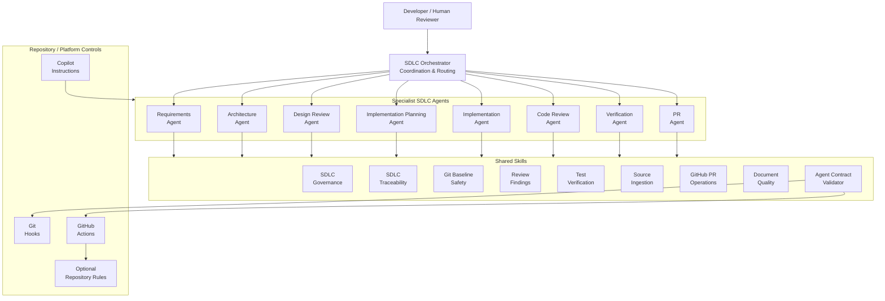

---

# 4. Lifecycle Architecture

The governed lifecycle is:

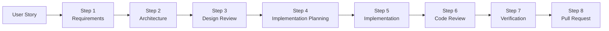

Lifecycle phases are sequential at the governance level, but remediation may temporarily route execution back to an earlier owning phase.

---

# 5. Orchestration Model

The SDLC Orchestrator is a coordinator rather than a specialist.

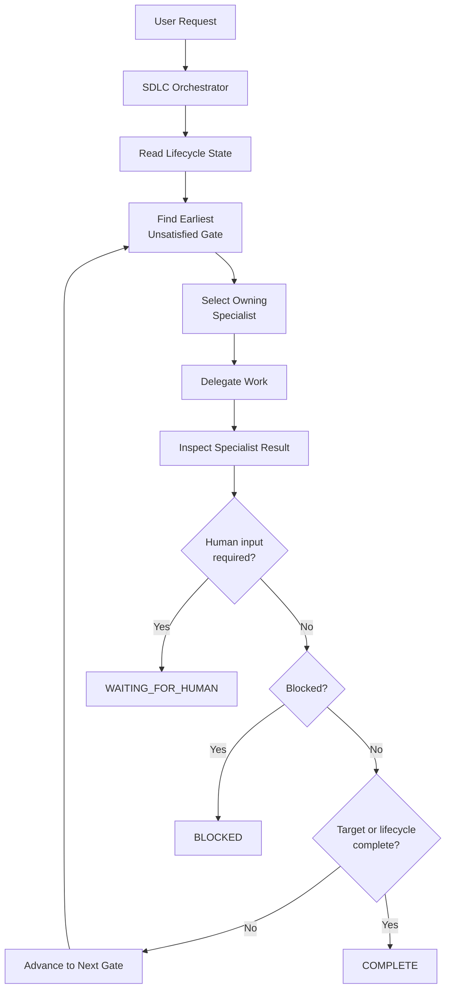

The orchestrator must not create specialist lifecycle artifacts itself.

---

# 6. Specialist Ownership Model

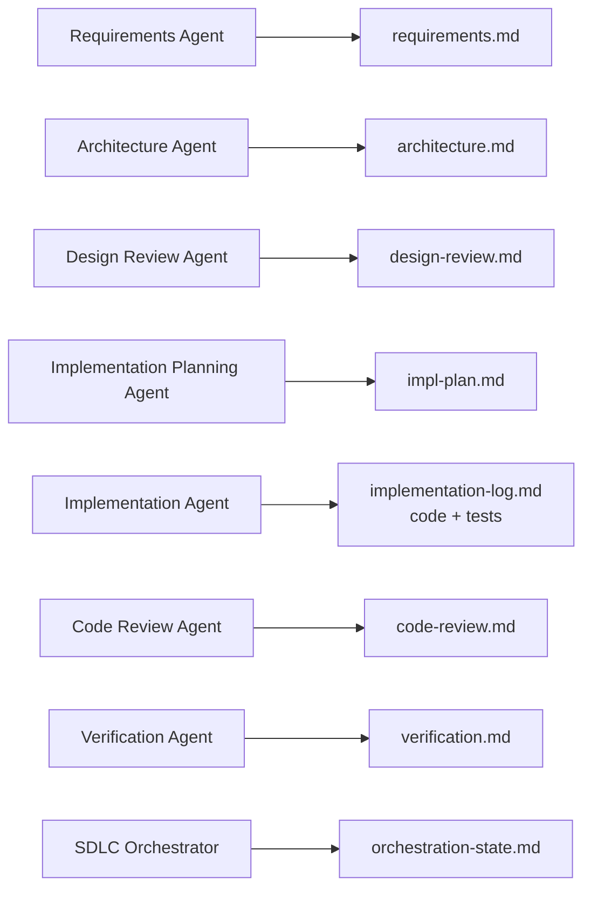

Artifact ownership is exclusive for lifecycle authority.

A downstream agent can identify an upstream issue but must route remediation back to the owning specialist.

---

# 7. Requirements-to-Delivery Traceability

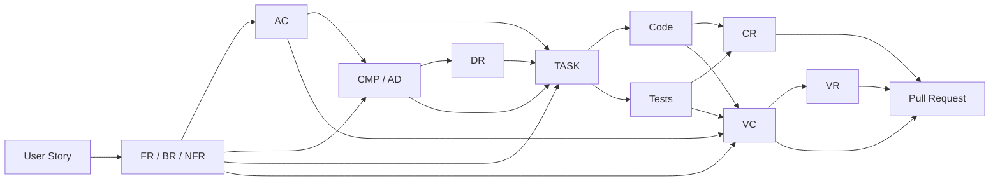

The model supports many-to-many traceability.

For example:

```text
FR-003
 ├── AC-004
 ├── AC-005
 ├── CMP-002
 ├── TASK-006
 ├── TASK-007
 ├── VC-010
 └── VC-011
```

---

# 8. Human Approval Gates

Human participation is intentionally preserved.

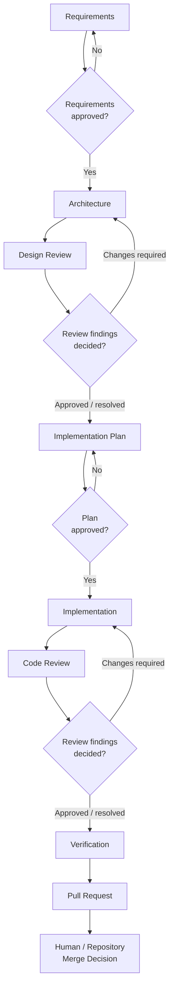

Agents may prepare decisions for humans but cannot fabricate the human response.

---

# 9. Design Review Remediation Loop

The Design Review Agent acts as an independent reviewer.

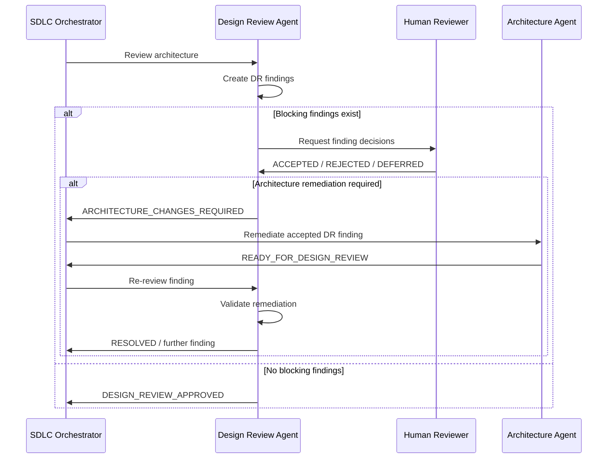

The Architecture Agent performs architecture remediation.

The Design Review Agent decides whether the remediation resolves the review finding.

---

# 10. Code Review Remediation Loop

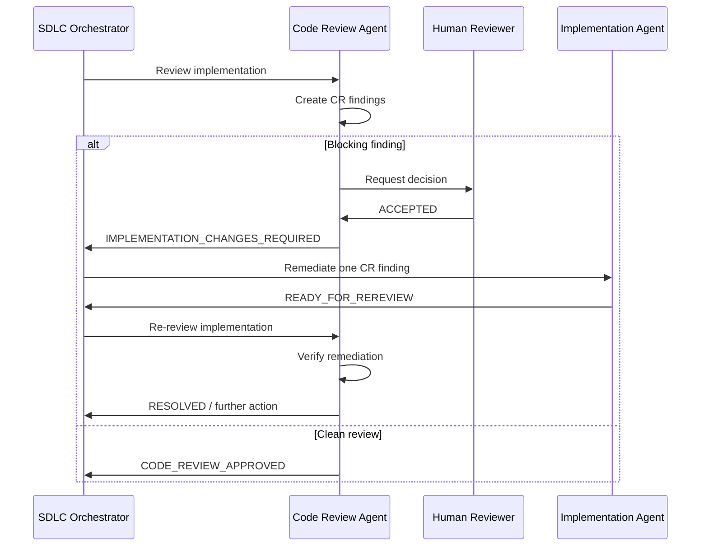

The Implementation Agent must never mark a `CR-###` finding resolved.

---

# 11. Verification Remediation Loop

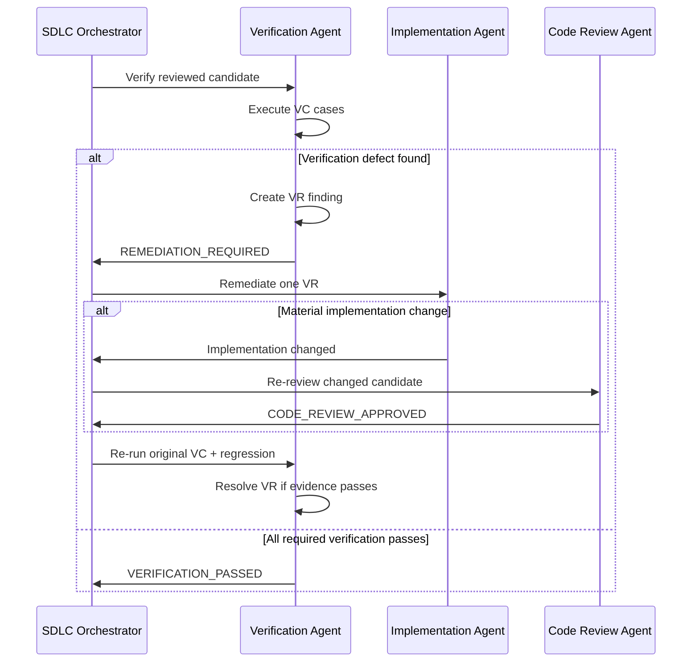

Material implementation changes after Code Review invalidate the prior reviewed baseline.

---

# 12. Shared Skill Architecture

Skills implement reusable procedures across agents.

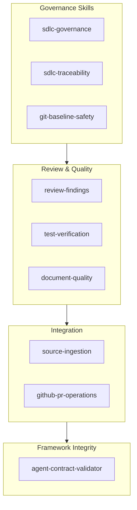

The skills are not lifecycle phases.

They provide reusable behavior to the specialist agents.

---

# 13. Repository Validation Architecture

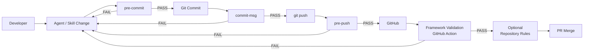

Local hooks provide fast feedback.

GitHub Actions provides independent repository-side validation.

Repository protection rules are optional for the learning project but can turn successful validation into a required merge gate.

---

# 14. Contract Validator

The deterministic contract validator is located at:

```text
.github/skills/agent-contract-validator/validate_agents.py
```

It checks framework-level contracts such as:

- expected agents
- expected skills
- agent frontmatter
- specialist tooling boundaries
- orchestrator delegation capability
- lifecycle markers
- artifact ownership markers
- traceability identifier namespaces
- required PR sections

Execute it with:

```bash
python3 .github/skills/agent-contract-validator/validate_agents.py
```

The desired result is:

```text
Result: PASS
Errors: 0
Warnings: 0
```

The validator supplements AI reasoning with deterministic structural validation.

---

# 15. Test Evidence Model

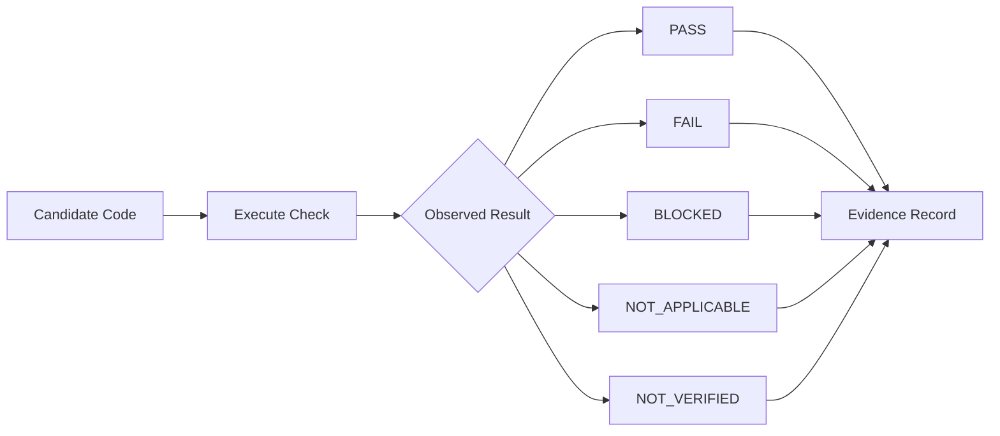

Only executed checks can be reported as passed.

`BLOCKED` and `NOT_VERIFIED` are never equivalent to `PASS`.

---

# 16. Baseline Integrity

Three concepts must remain distinct:

```text
Current Git Candidate
Reviewed Candidate
Verified Candidate
```

Conceptually:

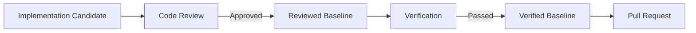

If code materially changes after Code Review:

```text
Code Review becomes stale.
```

If code materially changes after Verification:

```text
Code Review and Verification may both become stale.
```

The Git Baseline Safety skill governs these conditions.

---

# 17. Pull Request Boundary

The PR Agent operates only after the lifecycle gates are satisfied.

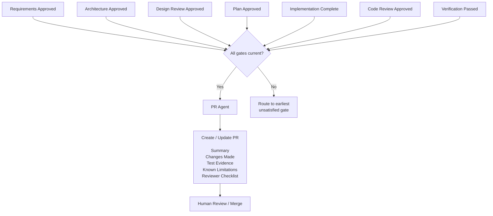

The PR Agent never performs the final merge.

---

# 18. Separation of Concerns

The intended architecture boundary is:

```text
Copilot Instructions
        ↓
Repository-wide conventions

Skills
        ↓
Reusable procedures

Specialist Agents
        ↓
Lifecycle reasoning and artifact ownership

SDLC Orchestrator
        ↓
Routing and lifecycle coordination

Git Hooks
        ↓
Fast local repository feedback

GitHub Actions
        ↓
Independent repository validation

Repository Rules
        ↓
Optional merge enforcement

Humans
        ↓
Approvals, governed decisions and final merge
```

This separation should be preserved when extending the framework.

---

# 19. Key Architecture Decisions

The framework intentionally uses:

**Separate Requirements and Architecture Agents**
Requirements define what the system must do. Architecture defines how the system should be structured.

**Independent Design Review**
The Architecture Agent must not review and silently approve its own architecture.

**Independent Code Review**
The Implementation Agent must not approve its own implementation.

**Separate Verification**
Passing implementation-level tests does not replace independent final verification.

**Shared Skills**
Cross-cutting procedures are centralized rather than copied into every agent.

**Explicit Human Gates**
AI automation must stop when a governed human decision is necessary.

**Persistent Traceability IDs**
Lifecycle relationships remain auditable across phases.

**Deterministic Contract Validation**
A Python validator checks framework structure independently of model reasoning.

---

# 20. Future Architecture Extensions

Potential learning extensions include:

```text
Agent behavioral evaluation suite
        ↓
Scenario-based orchestration tests
        ↓
Machine-readable artifact metadata
        ↓
Lifecycle event observability
        ↓
Architecture Decision Records
        ↓
Example completed SDLC project
        ↓
Framework versioning and releases
```

The priority should be proving the existing architecture end-to-end before introducing additional lifecycle agents.
